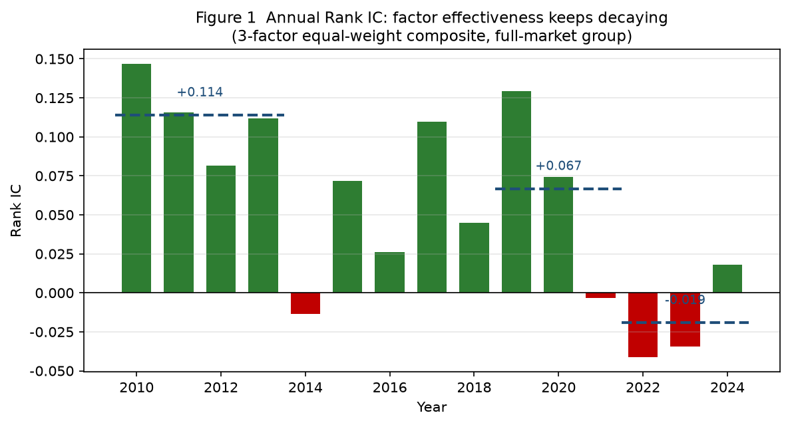
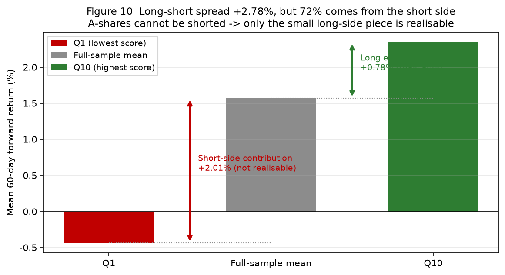
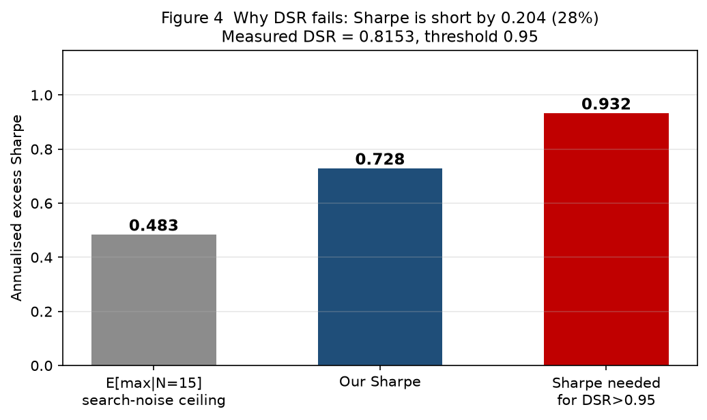
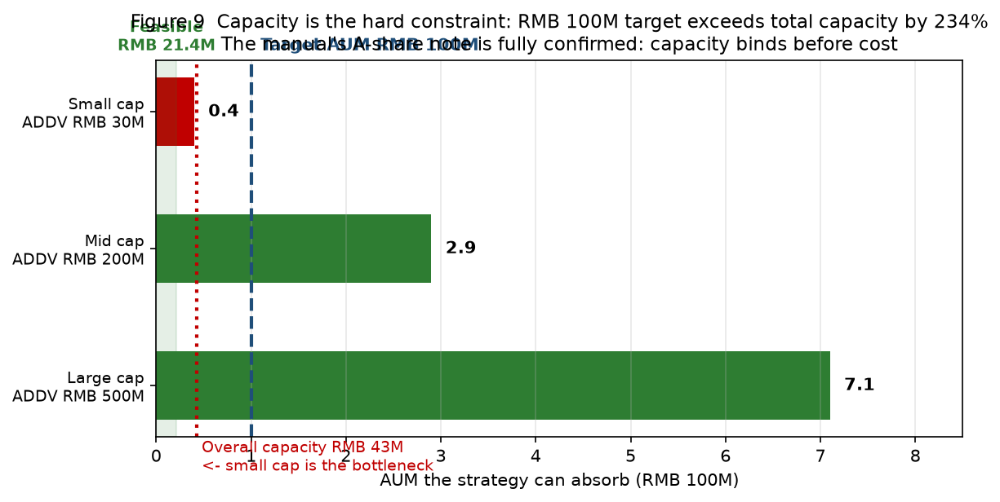
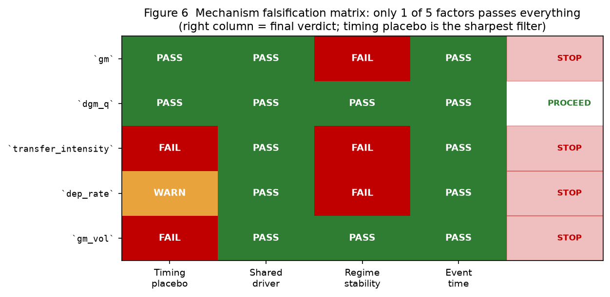

# A-Share Financial Factor Study

**A complete research pipeline run on CSMAR data: 41 steps / 37 hard gates → halted at step 33.**

**TL;DR — the point estimate is positive, but the statistical evidence is not sufficient. Verdict: *study further*.**

[](https://www.python.org/)
[](https://pandas.pydata.org/)
[](LICENSE)

**English** · [中文](README.zh-CN.md)

📄 **Reports:** [PDF (EN)](reports/A-Share_Factor_Study_Report_EN.pdf) · [DOCX (EN)](reports/A-Share_Factor_Study_Report_EN.docx) · [PDF (中文)](reports/A股财务因子研究报告_中文.pdf) · [DOCX (中文)](reports/A股财务因子研究报告_中文.docx) · [Markdown](REPORT.md)

---

## The question

> Can a listed company's **gross margin level and its quarter-on-quarter change** predict the stock's return over the **next 60 trading days**?

I ran this through a 41-step / 37-gate research protocol (business → data → features → model → evaluation → deployment) on 14.9M rows of CSMAR daily quotes and financial statements covering 5,970 A-share stocks from 2010 to 2026.

**The pipeline stopped at gate G5.4 (Deflated Sharpe Ratio > 0.95). I did not overrule it.**

---

## Headline results

| Metric | Value | Verdict |
|---|---|---|
| Sample | 2010-01-04 → 2026-11-18 · 5,970 stocks · 4,097 trading days | — |
| Candidate factors → passed mechanism test | 5 → **1** | ⚠️ |
| Rank IC (3-factor equal weight) | +0.0496 · HAC t = **3.06** | ✅ |
| Permutation test (200 draws, within-period shuffle) | p = **0.000** (8–14× the null p95) | ✅ |
| Annualised net return vs benchmark | +5.63% vs +4.36% | ✅ |
| **Long-only annualised net excess** | **+1.26%** | ⚠️ thin |
| **Break-even cost vs real cost** | **49.5bp vs 20.9bp = 2.36×** | ✅ |
| Sharpe (excess) | +0.728 · 95% CI [+0.193, +1.262] | ⚠️ wide |
| **Deflated Sharpe Ratio** | **0.8153** (threshold 0.95) | ❌ **fail** |
| Max drawdown / recovery | −53.7% / 8 periods (~2 years) | ⚠️ |
| Stress matrix | **5/8 positive** | ❌ |
| **Capacity** | **RMB 43M** (RMB 100M AUM exceeds by 234%) | ❌ |

**Pipeline progress: 33/41.**

---

## Read the results in five charts

### The factor is decaying



Mean IC **+0.114** in 2010-2013 → **−0.019** in 2022-2024. It no longer works.

### Excess sits almost entirely on the short side



Long-short spread +2.78%, but the long excess is only +0.78%. **A-shares cannot be shorted — 72% is not realisable.**

### Why DSR fails



Sharpe would need to rise from 0.728 to 0.932 (+28%), or the sample run 28 years instead of 17.

### Capacity binds before cost does



### Only 1 of 5 factors survives the mechanism tests



---

## The five things that actually mattered

**Not the conclusion — the process.**

### ① A horizon mismatch leaves a fingerprint

```
F0 check: fixed-asset footnote factors are disclosed annually, not quarterly
          → information freshness 250 trading days vs a 60-day label → 4× mismatch
        ↓
E1 timing placebo confirms it:
  transfer_intensity  lag 0 +0.0449 → lag 3 +0.0535   ← the 3-year-old report beats the latest
  gm_vol              lag 0 −0.0310 → lag 4 −0.0258   ← essentially flat
        ↓
Verdict STOP: these are slow-moving state variables, not information-driven signals
```

The only factor with correct horizon alignment (`dgm_q`) was also the only one passing all four falsification tests. **That is not a coincidence.**

### ② Metric drift is harder to spot than a coding bug

The same composite showed three different IC values across three documents:

| Source | IC | Cause |
|---|---|---|
| Model selection stage | 0.0402 | `rank` computed **within folds** (mixing ~14 periods) |
| Signal / model stage v1 | 0.0512 | `rank` computed **across the whole panel** (mixing 73 periods) |
| **Correct** | **0.0496** | **`rank` must be computed within each period** |

**None raised an error. None produced absurd numbers. They surfaced only under cross-checking.**

→ Built a metric registry ([docs/02_data/metric_spec.md](docs/02_data/metric_spec.md)) pinning down every metric's algorithm.

### ③ Short-side alpha is not a detail

| Factor | Long-short spread | Long excess | Short share |
|---|---|---|---|
| `dgm_q` | +1.421% | **+0.136%** | **90%** |
| 3-factor composite | +2.783% | **+0.777%** | 72% |

**Reporting only the long-short spread overstates the realisable edge by 3–10×.**

### ④ I made the same mistake twice

```
M-V stage: DSR's SR0 omitted the 1/sqrt(T-1) scaling  → threshold computed as 2.30 → all factors falsely invalid
E7  stage: T used periods (70) instead of years (17)  → DSR inflated to 1.0000
```

Both times the problem was **the definition of T**. The second time was *after* I had already fixed it once.

### ⑤ The gate rejected something that would have been mistaken for a result

Without the DSR gate, the report would have said *"net excess +1.26%, break-even 2.36×"* and gone to deployment — risking real capital on a claim that 17 years and 15 trials cannot statistically support.

**The gate did not reject a bug. It rejected a plausible-looking result.**

---

## Repository structure

```
a-share-factor-study/
├── README.md                 ← this file (EN)
├── README.zh-CN.md           ← 中文说明
├── REPORT.md                 ← full report (EN, Markdown)
├── REPORT.zh-CN.md           ← 完整报告（中文）
├── reports/                  ← formatted deliverables
│   ├── A-Share_Factor_Study_Report_EN.pdf / .docx
│   └── A股财务因子研究报告_中文.pdf / .docx
├── docs/                     ← 34 staged deliverables, by pipeline stage
│   ├── 01_business/          ← B: problem, feasibility, risk, plan
│   ├── 02_data/              ← D: audit, PIT, universe, labels, splits, metric spec
│   ├── 03_features/          ← F: specs, four feature classes, dedup, evaluation, governance
│   ├── 04_model/             ← M: selection, calibration, validation
│   ├── 05_evaluation/        ← E: mechanism, signal, model, backtest, cost, capacity, risk
│   └── 06_decision/          ← verdict + 7 death conditions
├── src/                      ← 36 reproducible scripts
│   ├── metrics.py            ← single implementation of every metric
│   ├── data/                 ← D2–D7
│   ├── features/             ← F0–F8
│   ├── model/                ← M-S / M-C / M-V (+ hand-written Ridge and GBDT)
│   ├── evaluation/           ← E1–E7
│   └── utils/                ← metric unification, drift forensics
├── results/
│   ├── figures/              ← 14 charts (Chinese labels)
│   ├── figures_en/           ← 14 charts (English labels)
│   └── tables/               ← 18 intermediate result JSONs
└── data/README.md            ← data contract (raw CSMAR data not committed)
```

---

## Reproduction

```bash
pip install -r requirements.txt
```

> **Path configuration**: the scripts resolve the data root from the
> `FACTOR_STUDY_ROOT` environment variable, defaulting to the repository root.
> Set it to the directory that holds your `CLEAN/` and `data/` folders, e.g.
> `$env:FACTOR_STUDY_ROOT = "D:\my-data\factor-study"` (PowerShell) or
> `export FACTOR_STUDY_ROOT=/my-data/factor-study` (bash).

**Data required** (export from CSMAR yourself; not committed):

| Data | File | Key fields |
|---|---|---|
| Daily quotes | `data/prices_YYYY.csv` | `code, date, open, close, high, low, volume, amount` |
| Adjustment factors | `data/adjfactor_YYYY.csv` | `code, date, adjfactor` |
| Tradability flags | `data/universe_YYYY.csv` | `code, date, tradable, hit_limit_up` |
| Income statement | `data/FS_Comins.csv` | `Stkcd, Accper, DeclareDate, B001100000, B001200000` |
| Balance sheet | `data/FS_Combas.csv` | `Stkcd, Accper, DeclareDate, A001212000, A001123000` |
| Fixed-asset footnote | `data/FN_Fn020.csv` | `Stkcd, Accper, Fn02003, Fn02004, Fn02007` |

```bash
python src/data/clean_all.py          # clean + adjust
python src/data/build_fin_factors.py  # factor panel
python src/data/d2_pit.py             # point-in-time alignment
python src/data/d3_universe.py        # universe flags
python src/data/d4_label.py           # build labels
python src/data/d5_split.py           # splits + holdout
python src/data/d6_missing.py         # missing-value policy
python src/data/d7_versioning.py      # version snapshot
# … then src/features/f0 … f8, src/model, src/evaluation/e1 … e7
```

**Canonical conventions** (single source: `src/metrics.py` + `docs/02_data/metric_spec.md`):

```
Within-period rank     groupby(accper_dt).rank(pct=True)
IC unit                one cross-sectional Spearman per period, then averaged
t-statistic            Newey-West HAC, lag L = H = 60
Sample size n          number of effective periods (not stock-days)
Composite              equal weight, denominator = number of available factors
DSR's T                years (not periods)
```

---

## Key design decisions and their justification

| Decision | Justification |
|---|---|
| **Zero-parameter equal weight**, no Ridge/GBDT | n = 64 independent periods; `p/n < 1/50` requires p < 1.28. Ridge (p=3) already violates it by 2.3× |
| **Next-open-to-open label** | Decide at T close → execute at T+1 open; avoids same-bar execution (a tradability look-ahead) |
| **Legal filing deadline as announcement-date proxy** | CSMAR `DeclareDate` fill rate is only 5–8%. The deadline is conservative yet gives 100% coverage |
| **Long-side excess only** | A-shares cannot be shorted; 72–90% of the spread is on the short side |
| **Equal-weight universe benchmark** | An index would mix universe difference into the excess |
| **DSR on real NAV with T in years** | Using periods would disguise quarterly data as annual, understating uncertainty |

---

## Known limitations (10)

1. **Engine parity not done** — vectorised only, no event-driven cross-check
2. **Exposure attribution not done** — no industry (3.4% coverage), no float mcap, no style factors
3. **Industry-neutral IC only via 2 crude groups** (manufacturing vs not)
4. **Three stress tests are approximations** (execution delay, universe shrink, parameter drift)
5. **Conditional slippage modelling not done** (volatility-, time-of-day-, crisis-scaled)
6. **SHAP attribution not implemented** — inapplicable to a zero-parameter model, but the rule is registered
7. **holdout not unlocked** — deferred because DSR failed
8. **ADDV values are assumptions** (RMB 500M / 200M / 30M)
9. **regime slices have only 12–20 observations each**
10. **The D4-stage turnover estimate was 2× too high** (corrected by E4 measurement)

---

## Data source

- **CSMAR** daily quotes, income statements, balance sheets, fixed-asset footnotes
- Raw data is **not** committed; see `data/README.md`
- Research and methodology demonstration only. **Not investment advice.**

---

## License

MIT
