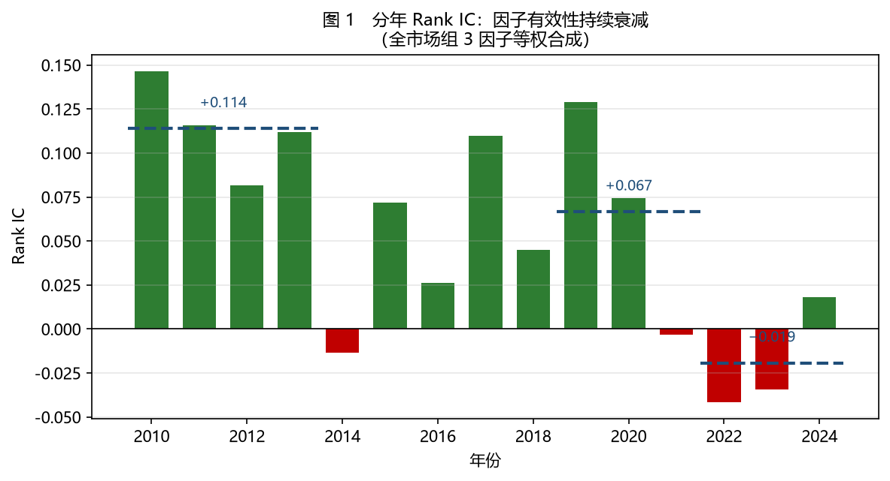
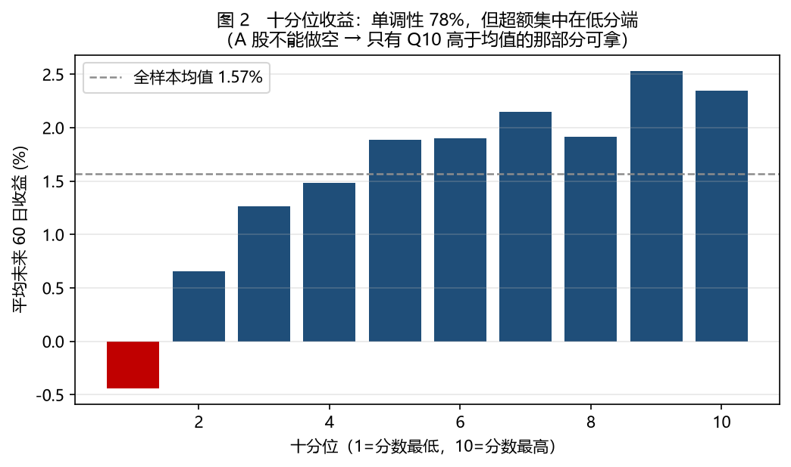
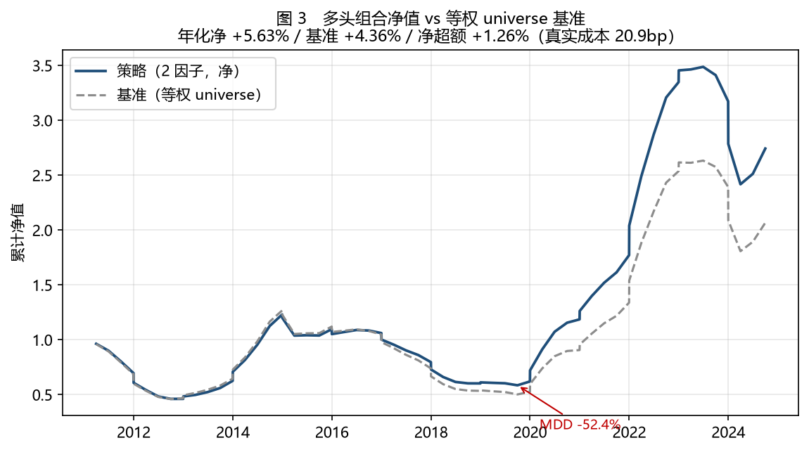
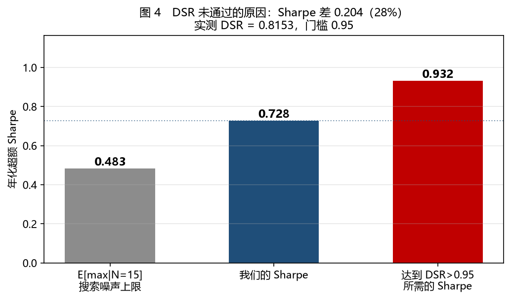
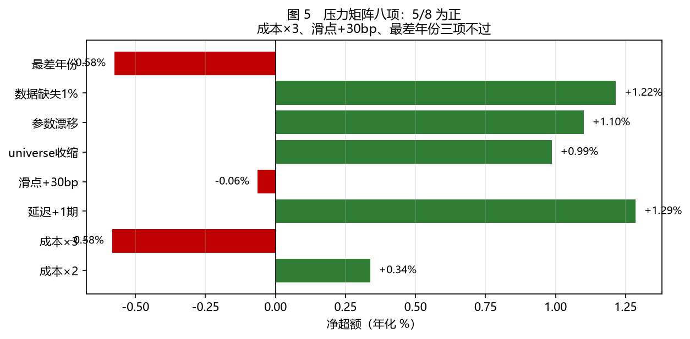

# A 股财务因子研究

[English](README.md) · **中文**

---


**用 CSMAR 数据、按 MLFT 七段流水线（41 步 / 37 道门禁）做一次完整的 A 股财务因子研究。**

结论先说：**点估计为正，但统计证据不足，判「再研究」。**

[](https://www.python.org/)
[](https://pandas.pydata.org/)
[](LICENSE)

---

## 一句话

> 我检验了「毛利率及其变化能否预测 A 股未来 60 日收益」。
> 多头组合年化净超额 **+1.26%**，盈亏平衡成本是真实成本的 **2.36 倍**——看起来能用。
> 但通缩夏普 **DSR = 0.8153 < 0.95**，容量上限只有 **2141 万**。
> 所以答案是：**再研究**，不是「成立」。

---

## 核心结果

| 指标 | 数值 | 判定 |
|---|---|---|
| 样本 | 2010-01-04 ~ 2026-11-18，5,970 只，4,097 交易日 | — |
| 因子数 | 5 个候选 → 机制检验后 **1 个通过** | ⚠️ |
| Rank IC（3 因子等权） | +0.0496，HAC t = **3.06** | ✅ 过 t>3 |
| 置换检验 | p = **0.000**（真实 IC 是零分布 p95 的 8~14 倍） | ✅ |
| 年化净收益 | **+5.63%** vs 基准 +4.36% | ✅ |
| **多头端年化净超额** | **+1.26%** | ⚠️ 薄 |
| **break-even** | **49.5bp（2.36× 真实成本 20.9bp）** | ✅ 过 2× |
| Sharpe（超额） | +0.728（95% CI [+0.193, +1.262]） | ⚠️ 宽 |
| **DSR** | **0.8153**（门槛 0.95） | ❌ **不过** |
| 最大回撤 | −53.7%（恢复 8 期 ≈ 2 年） | ⚠️ |
| 压力矩阵 | **5/8 为正** | ❌ |
| **容量** | **0.43 亿**（1 亿 AUM 超 234%） | ❌ |

**流水线进度：33/41，止步于 E7 的 G5.4（DSR > 0.95）。**

---

## 五张图看懂结论

### 图 1　因子在衰减



2010-2013 平均 IC **+0.114** → 2022-2024 平均 **−0.019**。近期已失效。

### 图 2　超额几乎全在空头端



多空价差 +2.78%，但多头超额只有 +0.78%——**A 股不能做空，72% 拿不到**。

### 图 3　净值 vs 等权基准



### 图 4　DSR 为什么不过



需要 Sharpe 从 0.728 提到 0.932（+28%），或把样本从 17 年延长到 28 年。

### 图 5　压力矩阵 5/8



成本 ×3、滑点 +30bp、最差年份三项不过。

---

## 这个项目真正有价值的部分

**不是结论，是过程。以下五件事比「策略是否成立」更重要。**

### ① 时限错配会在机制检验上现形

```
F0 检查发现：资产负债表附注因子只有年报披露 → 信息新鲜度 250 交易日
              而标签 H=60 → 4 倍时限错配
        ↓
E1 的 timing placebo 确诊：
  transfer_intensity  k0 +0.0449 → k3 +0.0535   ← 3 年前的年报比当期还强
  gm_vol              k0 −0.0310 → k4 −0.0258   ← 几乎完全平坦
        ↓
裁决 STOP：它们是"慢变状态变量"，不是信息驱动的信号
```

**而唯一时限对齐正确的 `dgm_q`，也是唯一通过全部四项证伪的因子。这不是巧合。**

### ② 口径漂移比算法错误更难发现

同一个组合，三个文档里出现过三个不同的 IC：

| 出处 | IC | 原因 |
|---|---|---|
| M-S | 0.0402 | rank 在「折内」做（跨 14 期混排） |
| E2 / E3 v1 | 0.0512 | rank 在「整面板」做（跨 73 期混排） |
| **正确** | **0.0496** | **rank 必须在「期内」做** |

三者都不报错、数字都不荒谬，**只在交叉核对时暴露**。

→ 因此建了 [`docs/02_data/metric_spec.md`](docs/02_data/metric_spec.md) 把唯一算法固定下来。

### ③ 空头端的 alpha 不是细节

| 因子 | 多空价差 | 多头超额 | 空头占比 |
|---|---|---|---|
| `dgm_q` | +1.421% | **+0.136%** | **90%** |
| 3 因子组合 | +2.783% | **+0.777%** | 72% |

**只报多空价差，会高估 3~10 倍。**

### ④ 同一个错误犯了两次

```
M-V：DSR 的 SR₀ 漏了 1/√(T−1)  → 门槛被算成 2.30 → 误判全部因子无效
E7 ：T 用了期数（70）不是年数（17）→ DSR 虚高到 1.0000
```

两次都是「T 的定义」出问题。第二次是在已经修过一次之后。

### ⑤ 门禁拦下的不是 bug，是一个会被当成成果的东西

如果没有 DSR 这道门，会带着「净超额 +1.26%、break-even 2.36×」去部署，
然后用 2141 万的真金白银验证一个统计上无法确认的东西。

---

## 仓库结构

```
a-share-factor-study/
├── README.md                  ← 本文件
├── REPORT.md                  ← 正式研究报告（含每步决策的依据）
├── requirements.txt
├── docs/                      ← 34 份阶段产物，按流水线分段
│   ├── 01_business/           ← B 段：问题、可行性、风险、计划
│   ├── 02_data/               ← D 段：审计、PIT、universe、标签、切分、口径表
│   ├── 03_features/           ← F 段：规格、四类特征、去重、评估、治理
│   ├── 04_model/              ← M 段：选择、校准、检验
│   ├── 05_evaluation/         ← E 段：机制、信号、模型、回测、成本、容量、风险
│   └── 06_decision/           ← 裁决与死亡条件
├── src/                       ← 36 个可复现脚本
│   ├── metrics.py             ← 指标唯一实现（IC / HAC / DSR / 十分位 / PSI）
│   ├── data/                  ← D2~D7
│   ├── features/              ← F0~F8
│   ├── model/                 ← M-S / M-C / M-V（含手写 Ridge + GBDT）
│   ├── evaluation/            ← E1~E7
│   └── utils/                 ← 口径统一、差异取证
├── results/
│   ├── figures/               ← 5 张关键图
│   └── tables/                ← 18 个中间结果 JSON
└── data/                      ← 数据契约（原始 CSMAR 数据不入库）
```

**操作手册与面试 QA 在项目外的 `手册/` 文件夹**（28 份），不属于代码仓库。

---

## 复现

```bash
pip install -r requirements.txt
```

**数据要求**（需自行从 CSMAR 导出，不入库）：

| 数据 | 文件 | 关键字段 |
|---|---|---|
| 日频行情 | `data/prices_YYYY.csv` | `code, date, open, close, high, low, volume, amount` |
| 复权因子 | `data/adjfactor_YYYY.csv` | `code, date, adjfactor` |
| 可交易标记 | `data/universe_YYYY.csv` | `code, date, tradable, hit_limit_up` |
| 利润表 | `data/FS_Comins.csv` | `Stkcd, Accper, DeclareDate, B001100000, B001200000` |
| 资产负债表 | `data/FS_Combas.csv` | `Stkcd, Accper, DeclareDate, A001212000, A001123000` |
| 固定资产附注 | `data/FN_Fn020.csv` | `Stkcd, Accper, Fn02003, Fn02004, Fn02007` |

**执行顺序**：

```bash
python src/data/clean_all.py          # 清洗 + 复权
python src/data/build_fin_factors.py  # 因子面板
python src/data/d2_pit.py             # PIT 时点对齐
python src/data/d3_universe.py        # universe 标记
python src/data/d4_label.py           # 标签构造
python src/data/d5_split.py           # 切分与 holdout
python src/data/d6_missing.py         # 缺失处理
python src/data/d7_versioning.py      # 版本快照
python src/features/f0_plan.py        # …直至 e7
```

**核心口径**（唯一来源：`src/metrics.py` + `docs/02_data/metric_spec.md`）：

```
期内 rank          groupby(accper_dt).rank(pct=True)
IC 单位            每期截面一次 Spearman，再对期平均
t 值               Newey-West HAC，滞后 L = H = 60
样本数 n           有效报告期数（不是股票-日）
合成              等权，分母 = 可用因子数
DSR 的 T          年数（不是期数）
```

---

## 关键设计选择与依据

| 选择 | 依据 |
|---|---|
| **零参数等权**，不用 Ridge/GBDT | n = 64 个独立期，`p/n < 1/50` 要求 p < 1.28；Ridge p=3 已超标 2.3 倍 |
| **next-open-to-open 标签** | T 日收盘决策 → T+1 开盘成交，避免同 bar 成交（可交易性前视） |
| **法定披露截止日代理公告日** | CSMAR `DeclareDate` 填充率仅 5~8%，用截止日保守但覆盖 100% |
| **只认多头端超额** | A 股不能做空，空头占 72~90% 不可变现 |
| **等权 universe 作基准** | 用指数会把「宇宙差异」混进超额（大小盘结构不同） |
| **DSR 用真实净值 + 年数** | 用期数会把「季频」伪装成「年频」，低估不确定性 |

---

## 已知局限（10 条）

1. **引擎 parity 未做**——只有向量化引擎，无事件驱动对照
2. **暴露归因未做**——无行业（3.4% 覆盖）、无流通市值、无风格因子
3. **行业内 IC 只有 2 组粗代理**（制造业/非制造业）
4. **压力矩阵三项是近似**（执行延迟、universe 收缩、参数扰动）
5. **滑点的条件建模未做**（波动相关、时段相关、危机放大）
6. **SHAP 归因未实现**——对零参数模型不适用，但规则已登记
7. **holdout 未解锁**——因 DSR 不过而推迟
8. **ADDV 是假设值**（5 亿 / 2 亿 / 3000 万）
9. **regime 每态仅 12~20 观测**，量级不可信
10. **D4 的换手预估偏高 2 倍**（已被 E4 实测纠正）

---

## 数据来源

- **CSMAR**（国泰安）日频行情、利润表、资产负债表、固定资产附注
- 数据不入库；`data/README.md` 说明导出要求
- 研究用途，非投资建议

---

## License

MIT

