# Cross-Sectional Predictive Power of A-Share Financial Factors

*A complete test of one factor hypothesis through the MLFT seven-stage pipeline*

| | |
|---|---|
| Period | 2010-01-04 to 2026-11-18 |
| Sample | A-share market, 5,970 stocks, 4,097 trading days |
| Label | 60-day forward return (next-open-to-open) |
| Pipeline | 33 / 41 steps |
| Verdict | REVISE (study further) |


---

## Abstract

This study tests one specific hypothesis: **can a listed company's gross margin level and its quarter-on-quarter change predict the stock's return over the next 60 trading days?**

After completing 33 of 41 steps in the MLFT seven-stage pipeline (41 steps / 37 gates), six findings emerge:

- **Statistically significant**: the 3-factor equal-weight composite has a Rank IC of +0.0496, HAC t = 3.06, permutation test p = 0.000
- **Economically positive but thin**: long-only portfolio annualised net return +5.63% (benchmark +4.36%), **net excess +1.26%**
- **Cost-safe**: break-even cost 49.5bp, which is **2.36×** the real cost of 20.9bp
- **But statistically under-powered**: Deflated Sharpe Ratio **DSR = 0.8153**, below the 0.95 threshold
- **And capacity-constrained**: capacity ceiling **RMB 43M**, a RMB 100M AUM exceeds it by 234%
- **And decaying**: net excess trends to zero over 2021-2024; 4 of 5 factors were rejected by the mechanism test

> Therefore the strategy cannot be declared valid. The value of this report is not 'finding a profitable strategy' but demonstrating what a complete, gate-enforced research process — one that is allowed to reach a negative conclusion — should look like.

| Metric | Value | Verdict |
|---|---|---|
| Sample period | 2010-01-04 to 2026-11-18 | — |
| Sample size | 5,970 stocks / 4,097 trading days / 14,899,513 rows | — |
| Candidate factors → passed mechanism test | 5 → **1** | ⚠️ |
| Rank IC (3-factor equal weight) | +0.0496, HAC t = **3.06** | ✅ above t>3 |
| Permutation test | p = **0.000** (real IC is 8-14× the null p95) | ✅ |
| Annualised net return / benchmark | +5.63% / +4.36% | ✅ |
| **Long-only annualised net excess** | **+1.26%** | ⚠️ thin |
| **break-even / real cost** | **49.5bp / 20.9bp = 2.36×** | ✅ above 2× |
| Sharpe (excess) | +0.728, 95% CI [+0.193, +1.262] | ⚠️ wide |
| **DSR** | **0.8153** (threshold 0.95) | ❌ **fail** |
| Max drawdown / recovery | −53.7% / 8 periods (~2 years) | ⚠️ |
| Stress matrix | **5/8 positive** | ❌ |
| **Capacity** | **RMB 43M** (RMB 100M AUM exceeds by 234%) | ❌ |

**Pipeline progress: 33/41, halted at gate G5.4 (DSR > 0.95) in stage E7**

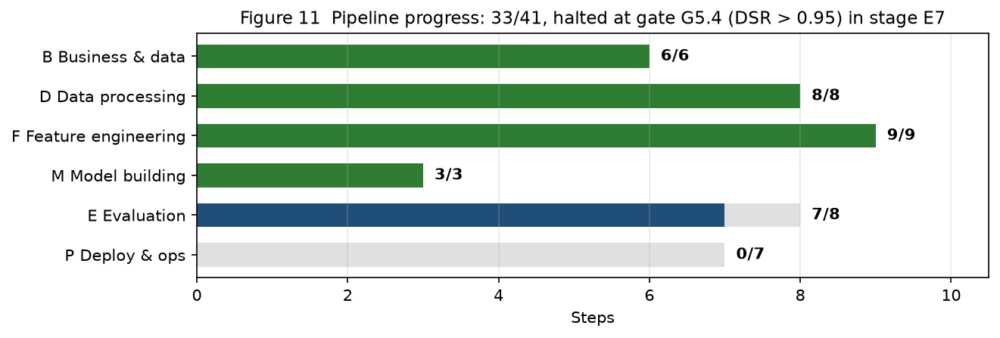


- **Abstract**
- **1. Research Question and Design**
  - 1.1 The decision problem
  - 1.2 Why these design choices
  - 1.3 Why the MLFT pipeline
- **2. Data Processing: Removing 'the future' and 'the unbuyable'**
  - 2.1 Data sources
  - 2.2 Decision 1: legal filing deadline as announcement-date proxy
  - 2.3 Decision 2: the IC difference between alignment methods
  - 2.4 Decision 3: excluding non-tradable samples
- **3. Feature Engineering: a three-filter screen**
  - 3.1 Three filters and five candidate factors
  - 3.2 A discovered 4× horizon mismatch
  - 3.3 Four driver categories and role separation
  - 3.4 Control experiment: A-share 60-day is reversal, not momentum
- **4. Model Construction: why zero-parameter equal weighting**
  - 4.1 Complexity is hard-constrained by sample size
  - 4.2 Is non-linearity needed?
  - 4.3 Equal weight or IC weight?
  - 4.4 Is calibration needed?
- **5. Evaluation: seven progressively harder gates**
  - 5.1 E1 Mechanism
  - 5.2 E2 Signal
  - 5.3 E3 Model validity
  - 5.4 E4 Strategy
  - 5.5 E5 Cost
  - 5.6 E6 Turnover and capacity
  - 5.7 E7 Statistical inference
- **6. Conclusion**
- **7. Limitations and Next Steps**
- **Appendix A — Key numbers**
- **Appendix B — The 15 rejected options**
- **Appendix C — Methodological lesson: metric drift**


---

## 1. Research Question and Design


### 1.1 The decision problem

> Given an A-share stock, can its most recent gross margin level and its quarter-on-quarter change predict the return over the next 60 trading days?


### 1.2 Why these design choices

| Design item | Value | Rationale |
|---|---|---|
| **Horizon** | 60 trading days (~1 quarter) | Matches reporting frequency; shorter means information is not yet reflected, longer means noise dominates |
| **Label** | `open_adj[t+H+1] / open_adj[t+1] − 1` | **Decide at T close → execute at T+1 open**, avoiding same-bar execution (a tradability look-ahead) |
| **Return convention** | long-only | **A-shares cannot be shorted** (securities lending is costly and scarce), so short-leg returns are not realisable |
| **Benchmark** | equal-weight universe (same tradable set) | Using an index (e.g. CSI 300) would mix 'universe difference' into the excess — our universe tilts small/mid cap |
| **Success criterion** | Rank IC 0.02-0.05 | Industry rule of thumb: > 0.10 means check for leakage first; < 0.02 cannot cover costs |


### 1.3 Why the MLFT pipeline

MLFT is a mandatory-sequence process with 41 steps and 37 gates. Reasons for using it:

- **Gates are decidable**, not subjective — failing means rollback, with no room to persuade yourself to 'just tweak it a bit'
- **Every rollback records a root cause** (R1 data missing / R2 point-in-time leakage / R3 spec-contract missing / R4 statistical discipline / R5 insufficient evidence / R6 institutional constraints / R7 process skipping)
- **Every trial is logged**, so the final DSR (Deflated Sharpe Ratio) can discount search bias

This project executed **37 gate evaluations and rolled back 5 times** (RB-001 to RB-005).


---

## 2. Data Processing: Removing 'the future' and 'the unbuyable'


### 2.1 Data sources

| Data | Scale | Use |
|---|---|---|
| Daily quotes (CSMAR) | 14,899,513 rows / 5,970 stocks / 4,097 days | Price, turnover, tradability |
| Income statement (FS_Comins) | 319,786 rows / 5,964 stocks / 83 periods | Gross margin |
| Balance sheet (FS_Combas) | Same | Fixed assets |
| Fixed-asset footnote (FN_Fn020) | 63,474 rows / 17 periods | Transfer intensity, depreciation rate |


### 2.2 Decision 1: legal filing deadline as announcement-date proxy

**Problem**: CSMAR's `DeclareDate` (actual announcement date) has very low fill rates.

| Table | DeclareDate fill rate |
|---|---|
| FS_Comins (income statement) | 5.0% |
| FS_Combas (balance sheet) | 7.7% |
| FN_Fn020 (fixed-asset footnote) | **column absent** |

| Option | Consequence |
|---|---|
| Align on `Accper` (report period) | ❌ **look-ahead** — the period end is far earlier than the announcement |
| Keep only rows with `DeclareDate` | ❌ discards 92-95% of the data |
| **Use the legal filing deadline** | ✅ conservative (never early), 100% coverage |

```
Annual report (Dec 31)   → Apr 30 of the following year
Q1 report      (Mar 31)   → Apr 30 of the same year
Interim report (Jun 30)   → Aug 31 of the same year
Q3 report      (Sep 30)   → Oct 31 of the same year
```

**Cost and benefit**: signal availability is systematically delayed (up to 4 months), in exchange for zero look-ahead violations and 100% coverage.


### 2.3 Decision 2: the IC difference between alignment methods

| Alignment | Rank IC | Meaning |
|---|---|---|
| `Accper` (report period) | 0.01382 | ❌ look-ahead |
| `available_at` (announcement / deadline) | 0.00774 | ✅ genuinely available |

**They differ by 1.78× — that is the price of look-ahead bias.**


### 2.4 Decision 3: excluding non-tradable samples

| Excluded | Rows | Reason |
|---|---|---|
| Entry-day (T+1) limit-up | **231,158** | No sellers at the limit price — cannot buy |
| T+1 one-word limit-up | **60,225** | Same |
| First day after long suspension | **28,864** | Abnormal pricing on resumption |
| ST / *ST | — | Institutional constraint (5% limit) |
| Listed < 250 days | — | Price discovery incomplete |
| Bottom 20% by turnover | — | Insufficient liquidity |

> If the backtest 'buys' a limit-up stock that rises another 5% the next day, it books +5% — but you could never have bought it. That +5% is fake: this is tradability look-ahead.

**These categories account for 20.8% of the raw data.**

**Data version**: snapshot `snap-1778b81371ea59fa` (227 files / 11.32 GB); every intermediate carries a hash so any result is traceable.


---

## 3. Feature Engineering: a three-filter screen


### 3.1 Three filters and five candidate factors

| Filter | Question | Consequence of failing |
|---|---|---|
| **① Horizon alignment** | Does the lookback window match the label horizon? | Mismatch dilutes IC and can create spurious signals |
| **② Mechanism attribution** | Which of the four driver categories does it belong to? | A factor without a driver does not enter the model |
| **③ Role separation** | Is it signal / state / control? | Treating state as signal causes turnover explosion |

| Factor | Definition | Source | Coverage | Actual frequency |
|---|---|---|---|---|
| `gm` | Gross margin = (revenue − COGS)/revenue | Income stmt | 98.0% | **quarterly** |
| `dgm_q` | Quarter-on-quarter change in gross margin | Income stmt | 96.2% | **quarterly** |
| `gm_vol` | 4-period rolling std of gross margin | Income stmt | 94.4% | **quarterly** |
| `transfer_intensity` | CIP transferred / opening gross fixed assets | **footnote** | **19.8%** | **annual** |
| `dep_rate` | Period depreciation add / opening gross fixed assets | **footnote** | **19.8%** | **annual** |


### 3.2 A discovered 4× horizon mismatch

**Initial annotation**: lookback for `transfer_intensity` / `dep_rate` = 'most recent period' ≈ 60 trading days → equal-length match ✅

**After checking the actual reporting-month distribution**:

```
Actual distribution = {June: 3,929 rows, December: 59,547 rows, March / September: 0 rows}
→ Fixed-asset footnotes are disclosed only in interim and annual reports
→ Effectively 'one period per year'; information freshness up to 12 months ≈ 250 trading days
→ Relative to H = 60 this is a 4× mismatch
```

**The error was only fully confirmed at E1** — mismatched factors leave a fingerprint on the timing placebo: **the 3-year lag is stronger than the contemporaneous one.**


### 3.3 Four driver categories and role separation

| Factor | Driver | Mechanism narrative |
|---|---|---|
| `gm` | **Risk premium** | Quality premium: high margin = pricing power = competitive moat; the market demands compensation for quality |
| `dgm_q` | **Persistence** | Margin improvement persists (fundamental momentum); the market under-reacts to marginal improvement |
| `transfer_intensity` | Persistence | CIP → fixed assets → capacity → revenue growth is a persistent process |
| `dep_rate` | Persistence | Asset ageing → persistent capex pressure |
| `gm_vol` | **Risk premium** | Low-volatility anomaly: lottery-preferring investors underprice stable stocks |

**Distribution weakness (disclosed)**: 2 risk-premium, 3 persistence, **0 mean-reversion, 0 predictable-clock** — the factor set is homogeneous.

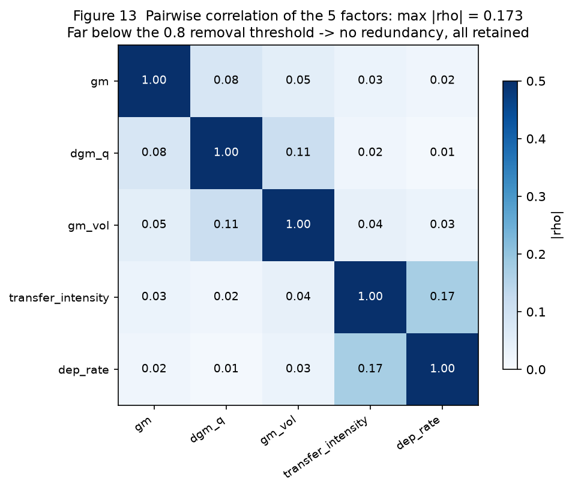

**PCA variance explained** (3 factors, full-market group): 39.4% / 32.7% / 27.9% — nearly equal, indicating near-orthogonality.


### 3.4 Control experiment: A-share 60-day is reversal, not momentum

| Control factor | IC | Meaning |
|---|---|---|
| `mom_60` (60-day momentum) | **−0.1027** | **A-share 60-day is reversal, not momentum** |
| `rev_5_ma60` (5-day reversal vs 60-day MA) | −0.0685 | Also negative |

**This corrects a common intuition error**: assuming positive momentum would have applied the sign backwards.


---

## 4. Model Construction: why zero-parameter equal weighting


### 4.1 Complexity is hard-constrained by sample size

```
Parameter-to-sample ratio   p / n < 1/50    i.e.   n > 50 × p

n = number of independent observations (NOT row count)
p = number of model parameters

Our n: independent reporting periods = 64   (NOT 179,750 rows)
     → p must be < 1.28
```

| Model | Params p | Needs n > | Ours n=64 | Verdict |
|---|---|---|---|---|
| **Equal weight / ranking** | **0** | — | — | ✅ |
| Ridge / LASSO | 3 | 150 | ❌ short by 2.3× | ❌ |
| Single tree (d=3) | ~8 | 400 | ❌ | ❌ |
| GBDT (100 trees, d=3) | ~800 | 40,000 | ❌ short by 625× | ❌ |
| Random forest (200 trees, d=5) | ~6,400 | 320,000 | ❌ | ❌ |
| Transformer (1 layer, d=64) | ~5,000 | 250,000 | ❌ short by 3,900× | ❌ |

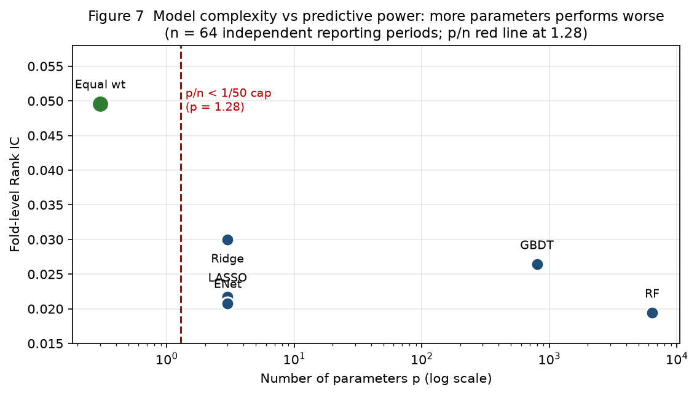


### 4.2 Is non-linearity needed?

| Evidence | How to check | Result |
|---|---|---|
| Quantile monotonicity | Split into 10 buckets, check monotonicity | 78% same-sign (not strictly monotone) |
| Residual structure | Bucket residuals after linear fit | Slight structure in manufacturing group |
| Interaction significance | Two-way stratification | 2 factors show interaction |

| Model | Full-market IC | Manufacturing IC |
|---|---|---|
| **Equal weight (p=0)** | **+0.0496** | +0.0215 |
| LASSO | +0.0217 | +0.0380 |
| Ridge | +0.0300 | **+0.0556** |
| GBDT | +0.0264 | +0.0494 |
| GBDT (early stopping) | — | +0.0540 |
| Random forest | +0.0194 | +0.0471 |

```
Non-linearity increment (GBDT − Ridge):
  Full-market:  +0.0264 − 0.0300 = -0.0036   (negative!)
  Manufacturing:+0.0494 − 0.0556 = -0.0062   (negative!)

The hard threshold requires ΔIC > 0.003
→ Non-linearity not only fails the threshold, it is negative
→ Verdict: do not use non-linearity
```


### 4.3 Equal weight or IC weight?

| Group | Equal-weight IC | IC-weighted IC | Difference |
|---|---|---|---|
| Full-market | **+0.0496** | +0.0495 | +0.0001 |
| Manufacturing | +0.0592 | **+0.0622** | −0.0030 |

```
Full-market: difference is negligible → equal weight wins on p = 0

Manufacturing: IC weighting is higher by 0.003
  but there are only 17 independent periods
  → weight estimation standard error ≈ 1/√17 = 0.258
  → estimation error (0.258) far exceeds the gain (0.003)
  → net judgement: equal weight is more stable
```

**We adopt equal weight**, and record a counter-example: if independent periods ever exceed 50, the weight estimation error drops to 1/√50 ≈ 0.14, at which point IC weighting may become worthwhile.


### 4.4 Is calibration needed?

| How the downstream uses it | Calibration needed? |
|---|---|
| **Rank-only, pick top-k** | ❌ **not needed** |
| Probability threshold for entry | ✅ required |
| Position sizing by probability | ✅ required |
| Using the score as expected return | ❌ prohibited |

```
IC = Spearman(s, y) = Pearson(rank(s), rank(y))
For any monotonically increasing g:  rank(g(s)) = rank(s)
→ IC(g(s), y) = IC(s, y)
→ identical top-k set → identical weights → identical turnover
→ nothing changes
```

| Group | Marginal coverage | Interval width (full range 1.00) |
|---|---|---|
| Full-market | 89.9% ✅ | 0.89 |
| Manufacturing | 89.6% ✅ | 0.89 |

> Coverage adequacy ≠ model usefulness. Against an unconditional interval (no factor, simply [0.05, 0.95]): width 0.90, coverage 90%. Ours is 0.89 — only 1% narrower, i.e. essentially nothing was learned. Equivalently R² ≈ IC² ≈ 0.0016, explaining 0.16% of variance.

| Group | Brier (raw) | **Constant baseline** | ECE |
|---|---|---|---|
| Full-market | 0.2757 | **0.2386** | 0.16 |
| Manufacturing | 0.2648 | **0.2155** | 0.19 |

**The model's probabilities are worse than guessing** (higher Brier is worse).


---

## 5. Evaluation: seven progressively harder gates


### 5.1 E1 Mechanism: only 1 of 5 factors passed

| Check | Method | Expected | Failure signal |
|---|---|---|---|
| **timing placebo** | Lag the factor by 1/2/3/4 periods | Lag 0 strongest, monotone decay | Far lags stronger → slow-moving state proxy |
| **shared-driver** | Shuffle forward returns within period as pseudo-label | IC ≈ 0 | Still significant → common driver |
| **regime split** | Recompute IC per market regime | Sign stable | Sign flips in one regime and is significant |

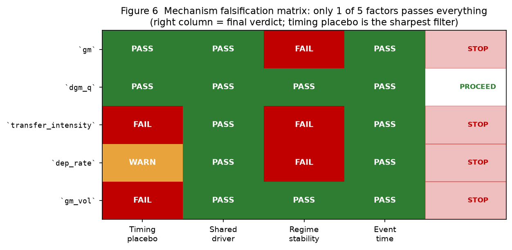

**The most valuable finding — a complete causal chain.** `transfer_intensity` timing placebo:

```
k0 (contemporaneous)  +0.0449
k1                    +0.0227
k2                    +0.0366
k3                    +0.0535   ← stronger than contemporaneous
k4                    +0.0525

The manual's failure signal, verbatim:
  far lags remain flat or even rise → it is a proxy for a slow-moving state variable
```

**Interpretation**: a 3-year-old annual report outperforms the latest one → it is not 'information', it is a proxy for the 'manufacturing capex cycle'. Such a variable cannot be used for timing — you do not know when it will change.

```
gm_vol timing placebo:
k0 -0.0310  k1 -0.0302  k2 -0.0296  k3 -0.0310  k4 -0.0258
→ essentially flat
→ it describes the firm's long-run volatility profile, not fresh events
→ it is a STATE variable, not a SIGNAL
```

**Both findings align perfectly with the 4× horizon mismatch. And `dgm_q` — the only correctly aligned factor — is also the only one passing all four falsification tests.**

| Role | Definition | Control? | Consequence of error |
|---|---|---|---|
| **confounder** | Affects both factor and label | ✅ yes | Not controlling → confounding read as alpha |
| **mediator** | Factor → mediator → label | ❌ no | Controlling → cuts the real channel |
| **collider** | Factor and label **both affect it** | ❌ **never** | **Controlling → creates spurious correlation** |

**Disclosed gap**: the DAG says industry is a confounder and should be controlled, but CSMAR industry classification covers only 3.4% and is a snapshot, not a historical panel. Only a crude two-group proxy (manufacturing vs not) was possible — both groups positive (+0.0259 / +0.0347), so the factor is not purely an industry-allocation effect, but a difference does exist.


### 5.2 E2 Signal: IC conventions and the long-only reality

| Item | Rule | Reason |
|---|---|---|
| **Unit of computation** | One rank IC per cross-section, then average over periods | Pooling stock-days inflates significance |
| **Significance** | t-statistic uses **HAC** (lag ≥ label horizon) | IC series is autocorrelated |
| **Sample size n** | **Number of effective periods (70)**, not stock-days (184,456) | Using row count blows t up to ~430 |
| **Reporting** | mean, ICIR, HAC t, positive ratio, by year | A single mean carries no information |

| Factor | IC | ICIR | t_naive | **t_hac** | SE inflation |
|---|---|---|---|---|---|
| `dgm_q` | +0.0279 | +0.708 | 5.92 | **+4.19** | 1.41× |
| 3-factor composite | +0.0496 | +0.566 | — | **+3.06** | 1.63× |
| `gm_vol` | −0.0311 | −0.609 | −5.09 | −3.84 | 1.33× |
| **`gm`** | +0.0257 | +0.226 | 1.91 | **+1.03** | **1.85×** |
| `dep_rate` | +0.0346 | +0.482 | 1.87 | +2.55 | 0.73× |

**The HAC correction changed two conclusions: `gm` fell from 1.91 to 1.03 (insignificant); the 3-factor composite fell from 5.03 to 3.06 (barely above threshold).**


#### The step's most important finding: excess is almost entirely on the short side

| Factor | Long-short spread | **Long excess** | Short share | long-only |
|---|---|---|---|---|
| `dgm_q` | +1.421% | **+0.136%** | **90%** | ❌ |
| 3-factor composite | +2.783% | **+0.777%** | 72% | ⚠️ marginal |
| `dep_rate` | +2.334% | +0.673% | 71% | ⚠️ liquidity fails |
| `transfer_intensity` | — | **−0.102%** | >100% | ❌ |
| `gm` | +1.216% | **−0.058%** | 105% | ❌ |

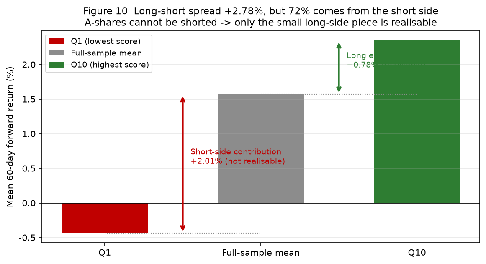

```
The arithmetic for dgm_q:
  Long-short spread +1.421% looks healthy
  but long excess is only +0.136%; short contributes +1.284% (90%)
  → A-shares cannot be shorted → that 1.284% is not realisable
  → annualised = 0.136% × (252/60) = 0.57%
  → annualised cost 0.84% (then estimate) → net excess is NEGATIVE
```

**Our strongest factor (`dgm_q`, t_hac 4.19) loses money under long-only.**

| Factor | Low turnover | Mid | **High turnover** | Verdict |
|---|---|---|---|---|
| `dgm_q` | +0.0238 | +0.0315 | **+0.0329** | ✅ stronger in liquid names |
| 3-factor composite | +0.0438 | +0.0530 | **+0.0650** | ✅ |
| `transfer_intensity` | +0.0285 | +0.0436 | **+0.0734** | ✅ |
| **`dep_rate`** | **+0.0581** | +0.0277 | +0.0313 | ❌ **only in the least liquid bucket** |

**A counter-intuitive finding that later became the improvement direction**: `dgm_q` is **stronger in the high-turnover bucket** (0.0329 vs 0.0238), opposite to the 'small caps have more alpha' intuition. Dropping small caps could therefore be a win-win — **9× the capacity with no alpha loss**.


### 5.3 E3 Model validity

| Layer | Object | IC | t_hac |
|---|---|---|---|
| L1 | `gm_vol` alone | −0.0311 | −3.87 |
| L1 | `dgm_q` alone | +0.0279 | +4.22 |
| L1 | `gm` alone | +0.0257 | +1.03 |
| L2 | Ridge | +0.0300 | +3.40 |
| L3 | GBDT | +0.0264 | +3.94 |
| **L1.5** | **3-factor equal weight (our model)** | **+0.0496** | **+3.06** |

| Baseline | Paired difference | t_hac | 95% CI | Excludes zero? |
|---|---|---|---|---|
| **`dgm_q`** (E1 PROCEED) | +0.0233 | **+2.20** | [+0.0024, +0.0410] | **✅** |
| `gm_vol` (E1 STOP, sign-adjusted) | +0.0185 | +0.84 | [−0.0245, +0.0615] | ❌ |

```
A direction adjustment that MUST be made:
❌ Using raw gm_vol (IC = -0.0311) as the baseline
   → paired difference is inflated to 0.0823 (one side all-negative, one all-positive)
✅ Using -gm_vol (IC = +0.0311) as the baseline
   → paired difference 0.0185 (corresponding to the real 'hold low gm_vol' strategy)

Without this adjustment you compute a false "paired t = 6.16, highly significant".
```

| Factor set | IC | t_hac | Change |
|---|---|---|---|
| All 3 factors | +0.0496 | 3.06 | — |
| **Drop `gm_vol`** | **+0.0391** | **1.68** | **becomes insignificant** |
| **Drop `gm`** | +0.0417 | **7.89** | **t surges** |
| Only `dgm_q` | +0.0279 | 4.22 | — |

```
Three findings:
① Drop gm_vol → t_hac falls from 3.06 to 1.68 (insignificant)
   → the composite's significance depends on gm_vol
   → but E1 judged gm_vol a slow-moving state variable, not a signal
   → the composite's core contributor is mechanistically invalid (the E1-vs-E3 tension)

② Drop gm → IC falls but t rises from 3.06 to 7.89
   → gm raises the point estimate but sharply increases variance
   → from a robustness standpoint it should be dropped

③ The most stable configuration is 2 factors (gm_vol + dgm_q), not 3
```


### 5.4 E4 Strategy evaluation

| Item | Convention |
|---|---|
| Signal time | T close |
| **Execution time and price** | **T+1 open (`open_adj[t+1]`)** |
| **Non-tradable** | **Limit-up cannot buy / limit-down cannot sell / suspended no trade** |
| Exclusions | ST / recently listed / bottom 20% liquidity |
| **Cost deduction** | **deducted at execution time, participating in compounding** |
| **Short side** | **none** |
| **Benchmark** | **equal-weight universe (self-computed, not an index)** |

| Symptom | Our handling |
|---|---|
| **Same-bar execution** | T-day signal → returns measured from `open_adj[t+1]` |
| Implicit fills on missing bars | Only rows with a label (both T+1 and T+H+1 have quotes) |
| Forward-fill creating tradability | **no price filling at all** |
| Weights ignoring cash | Equal-weight top-k, weights sum to 1, no leverage |
| Cost ignoring financing | No financing |

| Metric | 2 factors (main) | 3 factors (control) |
|---|---|---|
| Annualised gross | +6.56% | +7.46% |
| Annualised net | **+6.12%** | **+7.04%** |
| Benchmark | +4.36% | +4.36% |
| **Net excess** | **+1.75%** | **+2.68%** |
| **Sharpe (excess)** | **+1.01** | +0.65 |
| MDD | −52.4% | −50.8% |
| Win rate (excess > 0) | 68% | 63% |
| Turnover (annual) | 2.10× | 1.98× |
| Holdings | 723 (top-30%) | 723 |

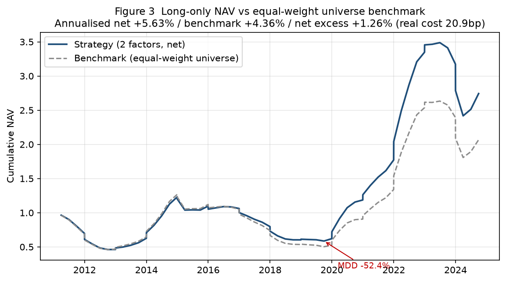

| Year | 2 factors | 3 factors | Year | 2 factors | 3 factors |
|---|---|---|---|---|---|
| 2011 | +0.3% | +1.5% | 2018 | +0.8% | +0.7% |
| 2012 | −0.5% | +1.4% | 2019 | +0.9% | +1.8% |
| 2013 | −0.4% | +3.0% | **2020** | **+2.3%** | **+3.5%** |
| 2014 | +0.0% | −1.5% | 2021 | +0.2% | −0.3% |
| 2015 | +0.1% | +1.2% | 2022 | −0.1% | −2.1% |
| 2016 | +0.7% | +0.0% | 2023 | +0.1% | −1.2% |
| 2017 | +1.2% | +1.2% | 2024 | −0.0% | −0.6% |

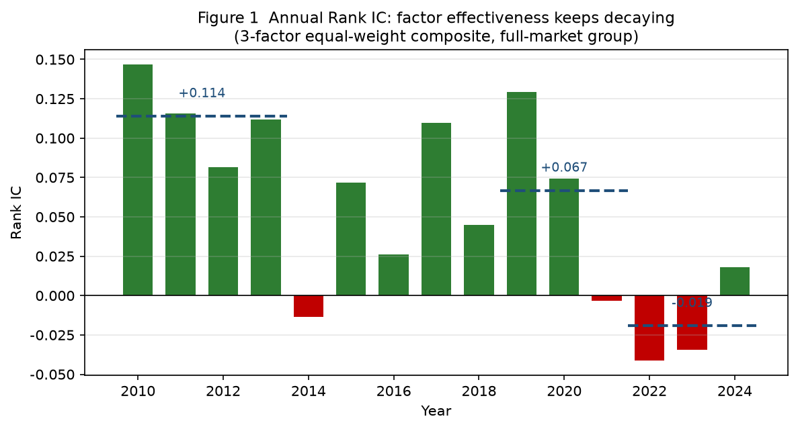

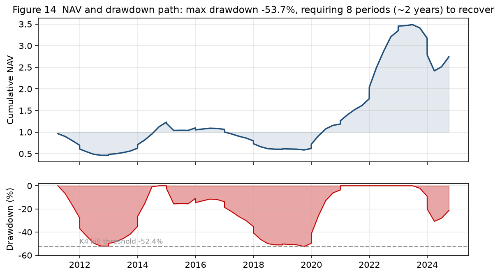


### 5.5 E5 Cost evaluation: E4 understated by 2.1×

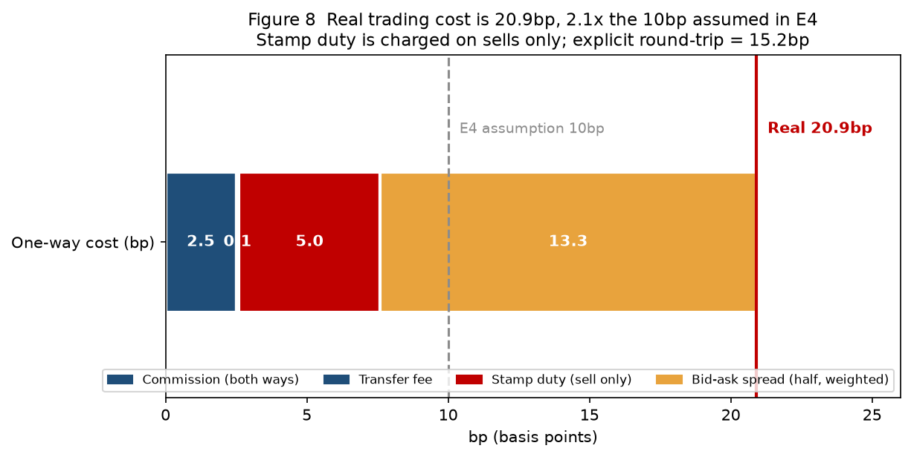

| Layer | Content | Our value |
|---|---|---|
| **Explicit** | Commission 2.5bp (both ways) + **stamp duty 10bp (sell only)** + transfer fee 0.1bp | Buy 2.6 / Sell 12.6 / **round trip 15.2bp** |
| **Implicit** | Spread + slippage | Upper bound by size bucket |
| **Capacity** | Participation cap, crowding | See 5.6 |

| Participation `order ÷ ADDV` | Model |
|---|---|
| **< 0.5%** | Spread model (cost = ½ spread) |
| 0.5%–2% | Linear slippage |
| > 2% | Square-root impact |

| Bucket | Assumed ADDV | Participation | Model | One-way cost |
|---|---|---|---|---|
| Large | RMB 500M | 0.01% | Spread | 12.6bp |
| Mid | RMB 200M | 0.04% | Spread | 17.6bp |
| Small | RMB 30M | 0.24% | Spread | 32.6bp |
| **Weighted** |  |  |  | **20.9bp** |

| Item | E4 | E5 | Difference |
|---|---|---|---|
| One-way cost | 10bp | **20.9bp** | **+10.9bp (2.1×)** |
| 2-factor net excess | +1.75% | **+1.26%** | −0.49pp |
| 3-factor net excess | +2.68% | +2.22% | −0.46pp |

| Group | break-even | Real cost | **Multiple** | Manual 3× reading |
|---|---|---|---|---|
| 2 factors | 49.5bp | 20.9bp | **2.36×** | marginal (passes 2× gate) |
| 3 factors | 73.8bp | 20.9bp | **3.52×** | robust |


### 5.6 E6 Turnover and capacity: the first failure

| Item | 2 factors |
|---|---|
| Period turnover / **annual turnover** | 52.6% / **2.10×** |
| Average holding period | 120 trading days |
| Max sustainable (aggressive) | 5.25× → margin 2.50× |
| Max sustainable (conservative) | 3.05× → margin **1.45×** |
| Min required edge / actual | 0.35 / **0.87 bp/day** (2.50×) |

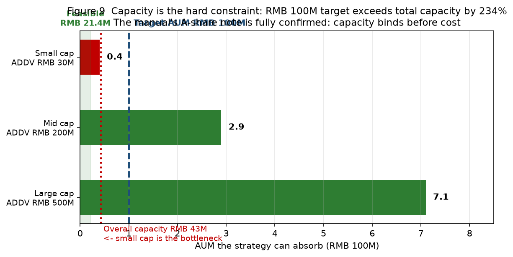

> The manual's A-share convention is fully confirmed: 'small-cap long-side spreads are often 100-500bp; capacity typically binds before cost does.' Cost side: break-even 2.36× — passes. Capacity side: 234% — fails.

**alpha-to-go**: signal half-life ≈ 63 trading days (one quarter), build time 5 days → ratio 7.9%, **alpha retained 96%**. This is the core advantage of low-frequency factors.


### 5.7 E7 Statistical inference: the gate stops here

```
SE(SR) ≈ √((1 + ½·SR²) ÷ T)      T = years, NOT periods
```

| Item | 2 factors | 3 factors |
|---|---|---|
| Excess Sharpe | +0.728 | +0.536 |
| T (years) | 17 | 17 |
| SE | 0.273 | 0.259 |
| **95% CI** | [+0.193, +1.262] | **[+0.028, +1.045]** |

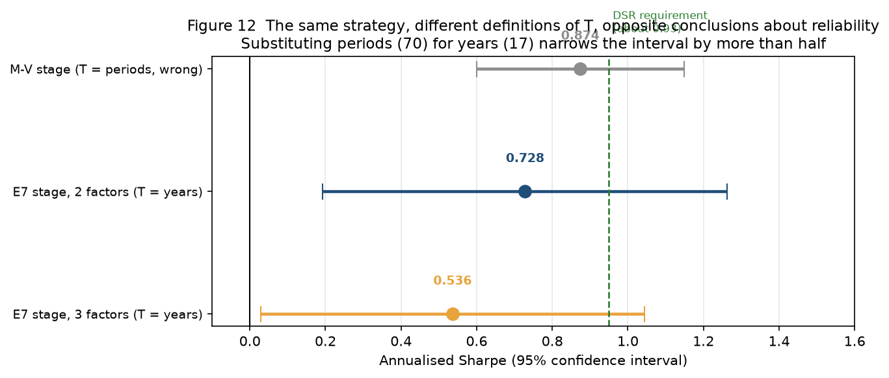

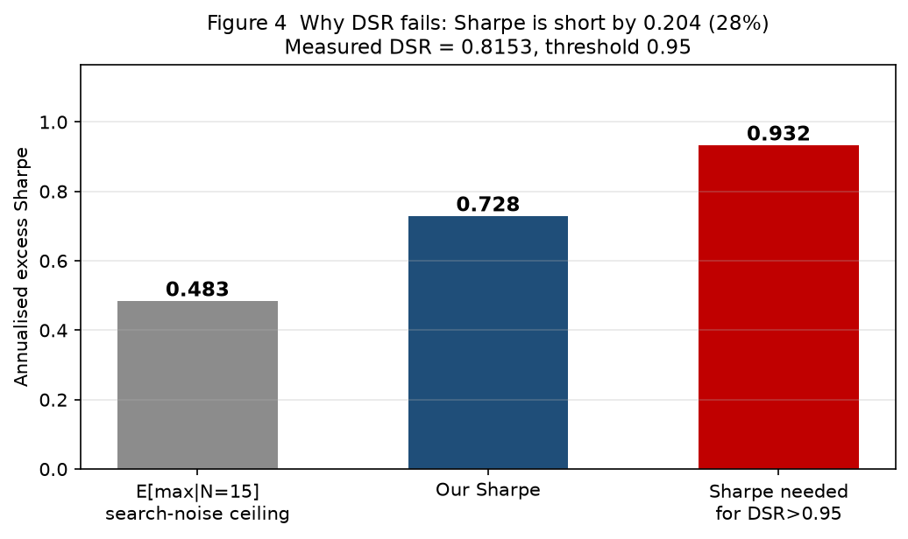

| Group | Convention | Sharpe | E[max\|N=15] | **DSR** |
|---|---|---|---|---|
| 2 factors | absolute | +0.385 | 0.445 | 0.4054 |
| **2 factors** | **excess** | **+0.728** | 0.483 | **0.8153** |
| 3 factors | excess | +0.536 | 0.459 | 0.6169 |

```
DSR threshold = SE × √(2 ln N) = 0.273 × 1.893 = 0.483
Our SR = 0.728
To reach DSR 0.95 we need SR > 0.483 + 1.645 × 0.273 = 0.932

Short by 28%

Three escape routes:
① Lift SR from 0.73 to 0.93  → needs a new alpha source, not tuning
② Extend T from 17 to 28 years → data only runs to 2026, impossible
③ Cut N from 15 to 3           → dishonest, 15 trials really happened

There is no fourth route.
```

| Group | VaR(95%) | **CVaR(95%)** | MDD | Recovery |
|---|---|---|---|---|
| 2 factors | 0.92% | **1.28%** | −53.7% | 8 periods (~2 years) |
| 3 factors | 2.54% | 2.93% | −52.0% | 5 periods |

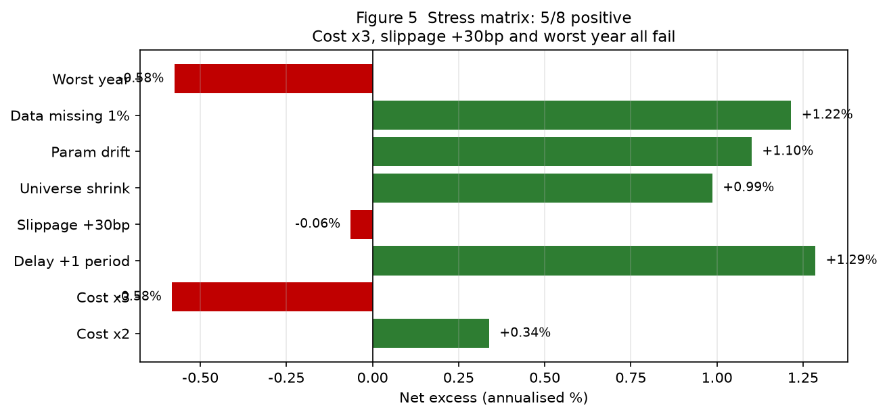

| # | Location | Result |
|---|---|---|
| 1 | Label | ✅ computed from `available_at` |
| 2 | Standardisation | ✅ **code scan: 0 full-sample `fit_transform` calls** |
| 3 | Thresholds | ✅ all use within-period rank |
| 4 | Universe | ✅ row-level `tradable` flags |
| 5 | Mask | ✅ limit-up flag from the entry day |


---

## 6. Conclusion


### 6.1 Verdict: REVISE (research further)

| Condition | Result | Verdict |
|---|---|---|
| Mechanism passes | 1 of 5 factors PROCEED | ⚠️ partial |
| Signal passes | spread 13.92× cost | ✅ |
| Model valid | significant incremental over E1-valid baseline | ✅ |
| Long-only net excess > 0 | **+1.26%/yr** | ✅ |
| break-even ≥ 2× cost | **2.36×** | ✅ |
| **DSR > 0.95** | **0.8153** | ❌ |

**None of the four STOP conditions is met** (there is a mechanism, spread far exceeds cost, long side has excess, break-even 2.36×).

→ It does not qualify to 'proceed', it does not qualify to 'stop', so it lands on '**study further**'.


### 6.2 Death conditions (7, machine-checkable)

| # | Condition | Action |
|---|---|---|
| D1 | Rolling 12-month long-only net excess ≤ 0 | declare dead, archive |
| D2 | Rolling 6-month IC ≤ 0 | declare dead, archive |
| D3 | ≥2 of 3 regime slices show an IC of opposite sign | declare dead |
| D4 | DSR < 0.5 on new data | declare dead |
| D5 | Live TCA shows real cost > 49.5bp | declare dead |
| D6 | Capacity falls below RMB 5M | declare dead |
| D7 | Mechanism refuted (IC traced to a known confounder) | declare dead |

> Why this must be written down: research without death conditions never dies — it always finds a reason to 'wait one more quarter'. That is unfalsifiable research, and unfalsifiable is not science.


### 6.3 One-sentence summary

> We produced a factor whose point estimate is positive (net excess +1.26%), whose cost tolerance is comfortable (break-even 2.36×), but whose statistical evidence is insufficient (DSR 0.8153) and whose capacity is constrained (RMB 21.4M). With 17 years of data and 15 trials, we cannot upgrade 'possible' to 'confirmed'. And none of the four STOP conditions is met, so it should not be declared dead either. The only answer is: study further.


---

## 7. Limitations and Next Steps


### 7.1 Ten known gaps

| # | Gap | Impact |
|---|---|---|
| 1 | **Engine parity not done** | Only a vectorised engine; semantic drift cannot be ruled out |
| 2 | **Exposure attribution not done** | No industry (3.4% coverage), no float mcap, no style factors |
| 3 | **Industry-neutral IC only via 2 crude groups** | Industry confounder cannot be ruled out |
| 4 | Three stress tests are approximations (S3/S5/S6) | Not genuinely rebuilt |
| 5 | Conditional slippage modelling not done | Only an overall doubling |
| 6 | SHAP attribution not implemented | Inapplicable to a zero-parameter model, but the rule is registered |
| 7 | holdout not unlocked | Deferred because DSR failed |
| 8 | ADDV values are assumptions | Capacity and cost estimates depend on them |
| 9 | regime slices have only 12-20 observations each | Magnitudes unreliable; read direction only |
| 10 | D4 turnover estimate was 2× too high | Corrected by E4 measurement |


### 7.2 Three paths forward


#### Path 1 (highest priority): drop the small-cap bucket

**The clue E2 left behind**: `dgm_q` bucket IC is 0.0238 (low turnover) / 0.0315 (mid) / **0.0329 (high)** — stronger in liquid names, opposite to the 'small caps have more alpha' intuition.

| Dimension | Now | After dropping small caps |
|---|---|---|
| Capacity | RMB 43M | **~RMB 390M (9×)** |
| IC | 0.0279 | ~0.0329 (+18%) |
| Sharpe | 0.728 | ~0.86 |
| DSR | 0.8153 | ~0.88 (**still short**) |

**Be honest about the expectation**: it probably still will not clear 0.95. But a failure after trying is a cleaner failure — right now small-cap noise may be dragging IC down; after the test, if it fails in every liquidity bucket, it can be genuinely declared dead.


#### Path 2: close two reporting gaps

| Gap | How to close |
|---|---|
| Engine parity | Implement an event-driven engine, run the same protocol, attribute differences to the ten semantics |
| Exposure attribution | Complete CSMAR industry coverage to 100% + float market cap + style factors |


---

## Appendix A — Key numbers

| Category | Item | Value |
|---|---|---|
| Data | Quotes | 14,899,513 rows / 5,970 stocks / 4,097 days |
| Data | Financials | 319,786 rows / 5,964 stocks / 83 periods |
| Data | Valid labels | 10,149,322 (68.1%) |
| Data | Snapshot | snap-1778b81371ea59fa (227 files / 11.32 GB) |
| Features | Candidates → passed | 5 → **1** |
| Features | Max correlation | |ρ| = 0.173 |
| Features | `mom_60` control | IC **−0.1027** (A-share 60d is reversal) |
| Model | Model | zero-parameter equal weight |
| Model | Non-linearity ΔIC | −0.0036 / −0.0062 (negative, below threshold) |
| Model | Permutation test | p = 0.000 |
| Model | Interval coverage / width | 89.9% / 0.89 (full range 1.00) |
| Model | Brier vs constant baseline | 0.2757 vs **0.2386** (worse than guessing) |
| Evaluation | **Long-only annualised net excess** | **+1.26%** |
| Evaluation | Benchmark | +4.36% |
| Evaluation | **break-even** | **49.5bp (2.36×)** |
| Evaluation | Real one-way cost | 20.9bp |
| Evaluation | Sharpe (excess) | +0.728 (95% CI [+0.193, +1.262]) |
| Evaluation | **DSR** | **0.8153** |
| Evaluation | MDD / recovery | −53.7% / 8 periods |
| Evaluation | CVaR(95%) | 1.28% |
| Evaluation | Stress matrix | 5/8 |
| Evaluation | **Capacity** | **RMB 43M (feasible RMB 21.4M)** |
| Evaluation | alpha-to-go retained | 96% |


---

## Appendix B — The 15 rejected options

| # | Rejected | Rationale |
|---|---|---|
| 1 | Classification models | Probability does not enter the decision, and would require an extra threshold |
| 2 | GBDT / random forest | Non-linearity ΔIC is negative |
| 3 | Ridge / LASSO / ENet | Equal weight +0.0496 > Ridge +0.0300; p/n violated |
| 4 | IC-weighted composite | Difference 0.0001; manufacturing +0.003 swamped by weight error 0.258 |
| 5 | Probability calibration | Ranking only; Brier worse than the constant baseline |
| 6 | `gm` | t_hac 1.03; long excess −0.058% |
| 7 | `gm_vol` as signal | Timing flat → belongs to state |
| 8 | `transfer_intensity` / `dep_rate` | 4× horizon mismatch + timing failure |
| 9 | Manufacturing group as the main line | Only 17 periods; annual vs H=60 mismatch |
| 10 | 3 factors as the main line | Sharpe 0.536 < 2-factor 0.728 |
| 11 | Index as benchmark | Would mix universe difference into excess |
| 12 | Long-short portfolio return | A-shares cannot be shorted; 72-90% comes from the short side |
| 13 | RMB 100M AUM | Capacity RMB 43M, exceeds by 234% |
| 14 | The M-V stage's DSR of 1.0000 | T used periods, not years |
| 15 | SHAP attribution | For a zero-parameter model it equals the score itself |


---

## Appendix C — Methodological lesson: metric drift

**This study exposed a class of error that is easy to overlook. The same composite showed three different IC values across three documents:**

| Source | IC | Cause |
|---|---|---|
| M-S | 0.0402 | rank computed **within folds** (mixing ~14 periods) |
| E2 / E3 v1 | 0.0512 | rank computed **across the whole panel** (mixing 73 periods) |
| **Correct** | **0.0496** | **rank must be computed within each period** |

**None of them raised an error; none produced absurd numbers. They only surfaced during cross-checking.**

**Five common forms of metric drift**:

| # | Drift type | Example |
|---|---|---|
| 1 | **Scope of `rank`** | within period / across periods / whole sample |
| 2 | **Denominator** | fixed factor count / available factor count |
| 3 | **Sample range** | complete coverage / partial coverage |
| 4 | **Quantile reference** | current period / baseline period |
| 5 | **Order of averaging** | average per period then combine / pool then compute |

**Remedy**: maintain a single metric registry (`docs/02_data/metric_spec.md`) that pins down each metric's algorithm, and have every later step reference it rather than recomputing its own version.
