# A 股财务因子的截面预测能力

*按 MLFT 七段流水线对一个因子假设的完整检验*

| | |
|---|---|
| 研究区间 | 2010-01-04 ~ 2026-11-18 |
| 样本 | A 股全市场，5,970 只，4,097 个交易日 |
| 标签 | 未来 60 交易日收益（next-open-to-open） |
| 流水线进度 | 33 / 41 步 |
| 最终裁决 | 再研究（REVISE） |


---

## 摘要

本研究检验一个具体假设：**上市公司的毛利率水平及其变化，能否预测其未来 60 个交易日的股票收益？**

按 MLFT 七段流水线（41 步 / 37 道门禁）完成 33 个步骤后，得到六条结论：

- **统计上显著**：3 因子等权合成的 Rank IC = +0.0496，HAC t = 3.06，置换检验 p = 0.000
- **经济上为正但薄**：多头组合年化净收益 +5.63%（基准 +4.36%），**净超额 +1.26%**
- **成本上安全**：盈亏平衡成本 49.5bp，是真实成本 20.9bp 的 **2.36 倍**
- **但统计证据不足**：通缩夏普 **DSR = 0.8153**，未达 0.95 门槛
- **且规模受限**：容量上限 **0.43 亿**，1 亿 AUM 超容量 234%
- **且正在衰减**：2021-2024 年净超额趋零，机制检验中 5 个因子有 4 个被判 STOP

> 因此不能宣称策略成立。本报告的价值不在于「找到一个赚钱的策略」，而在于展示一次完整的、带门禁的、允许得出否定结论的研究应该怎么做。

| 指标 | 数值 | 判定 |
|---|---|---|
| 样本区间 | 2010-01-04 ~ 2026-11-18 | — |
| 样本规模 | 5,970 只 / 4,097 交易日 / 14,899,513 行 | — |
| 候选因子 → 通过机制检验 | 5 个 → **1 个** | ⚠️ |
| Rank IC（3 因子等权） | +0.0496，HAC t = **3.06** | ✅ 过 t>3 |
| 置换检验 | p = **0.000**（真实 IC 是零分布 p95 的 8~14 倍） | ✅ |
| 年化净收益 / 基准 | +5.63% / +4.36% | ✅ |
| **多头端年化净超额** | **+1.26%** | ⚠️ 薄 |
| **break-even / 真实成本** | **49.5bp / 20.9bp = 2.36×** | ✅ 过 2× |
| Sharpe（超额） | +0.728，95% CI [+0.193, +1.262] | ⚠️ 宽 |
| **DSR** | **0.8153**（门槛 0.95） | ❌ **不过** |
| 最大回撤 / 恢复时间 | −53.7% / 8 期（约 2 年） | ⚠️ |
| 压力矩阵 | **5/8 为正** | ❌ |
| **容量** | **0.43 亿**（1 亿 AUM 超 234%） | ❌ |

**流水线进度：33/41，止步于 E7 的 G5.4（DSR > 0.95）**

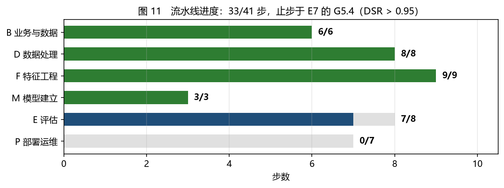


- **摘要**
- **一、研究问题与设计**
  - 1.1 决策问题
  - 1.2 为什么这样设定
  - 1.3 为什么用 MLFT 流水线
- **二、数据处理：剔掉「未来」和「买不到」**
  - 2.1 数据源
  - 2.2 决策一：用法定披露截止日代理公告日
  - 2.3 决策二：时点对齐的 IC 差异
  - 2.4 决策三：剔除不可成交样本
- **三、特征工程：三步滤网**
  - 3.1 三步滤网与 5 个候选因子
  - 3.2 一个被查出的 4 倍时限错配
  - 3.3 四类驱动与角色分离
  - 3.4 对照实验：A 股 60 日是反转不是动量
- **四、模型建立：为什么用零参数等权**
  - 4.1 复杂度受数据量硬约束
  - 4.2 非线性需不需要
  - 4.3 等权还是 IC 加权
  - 4.4 需不需要校准
- **五、评估：逐层加深的七道关卡**
  - 5.1 E1 机制评估
  - 5.2 E2 信号评估
  - 5.3 E3 模型是否成立
  - 5.4 E4 策略评估
  - 5.5 E5 成本评估
  - 5.6 E6 换手与容量
  - 5.7 E7 统计推断
- **六、结论**
- **七、局限与下一步**
- **附录 A　关键数字总表**
- **附录 B　被否掉的 15 个选项**
- **附录 C　方法论收获：口径漂移**


---

## 一、研究问题与设计


### 1.1 决策问题

> 给定一只 A 股股票，其最近一期财报的毛利率水平、及毛利率的环比变化，能否预测它未来 60 个交易日的收益？


### 1.2 为什么这样设定

| 设计项 | 取值 | 依据 |
|---|---|---|
| **预测期限** | 60 交易日（约 1 季度） | 与财报披露频率匹配；过短信息未反映，过长噪声主导 |
| **标签构造** | `open_adj[t+H+1] / open_adj[t+1] − 1` | **T 日收盘决策 → T+1 开盘成交**，避免「同 bar 成交」这一可交易性前视 |
| **收益口径** | long-only（只做多） | **A 股不能做空**（融券成本高、券源有限），空头端收益不可变现 |
| **基准** | 等权 universe（同一批可交易股票的等权平均） | 用指数（如沪深 300）会把「宇宙差异」混进超额——我们的 universe 偏中小市值 |
| **成功标准** | Rank IC 0.02~0.05 | 行业经验：> 0.10 先查泄漏；< 0.02 覆盖不了成本 |


### 1.3 为什么用 MLFT 流水线

MLFT 是 41 步 / 37 道门禁的强制顺序流程。选它的原因：

- **门禁是可判定的**，不是主观判断——不通过就退回，无法自我说服「再调调就好」
- **退回要记根因**（R1 数据缺失 / R2 时点泄漏 / R3 规格契约缺失 / R4 统计纪律 / R5 证据不足 / R6 制度约束 / R7 流程跳步）
- **试验要记账**，供最后的 DSR（通缩夏普）扣除搜索偏差

本次研究共执行 **37 次门禁，退回 5 次**（RB-001 ~ RB-005）。


---

## 二、数据处理：剔掉「未来」和「买不到」


### 2.1 数据源

| 数据 | 规模 | 用途 |
|---|---|---|
| 日频行情（CSMAR） | 14,899,513 行 / 5,970 只 / 4,097 交易日 | 价格、成交额、可交易性 |
| 利润表（FS_Comins） | 319,786 行 / 5,964 只 / 83 期 | 毛利率 |
| 资产负债表（FS_Combas） | 同上 | 固定资产 |
| 固定资产附注（FN_Fn020） | 63,474 行 / 17 期 | 转固强度、折旧率 |


### 2.2 决策一：用法定披露截止日代理公告日

**问题**：CSMAR 的 `DeclareDate`（实际公告日）填充率极低。

| 表 | DeclareDate 填充率 |
|---|---|
| FS_Comins（利润表） | 5.0% |
| FS_Combas（资产负债表） | 7.7% |
| FN_Fn020（固定资产附注） | **无此列** |

**三个选项**：

| 选项 | 后果 |
|---|---|
| 用 `Accper`（报告期）对齐 | ❌ **偷看未来**——报告期结束日远早于公告日 |
| 只用有 `DeclareDate` 的样本 | ❌ 丢掉 92~95% 的数据 |
| **用法定披露截止日** | ✅ 保守（永远不会提前），覆盖 100% |

**采用的代理规则**（依据《证券法》信息披露要求）：

```
年报（12-31）  → 次年 4 月 30 日
一季报（3-31） → 当年 4 月 30 日
半年报（6-30） → 当年 8 月 31 日
三季报（9-30） → 当年 10 月 31 日
```

**代价与收益**：信号可用时间被系统性推迟（最长 4 个月），但换来 0 处前视违规、覆盖率 100%。


### 2.3 决策二：时点对齐的 IC 差异

| 对齐方式 | Rank IC | 含义 |
|---|---|---|
| `Accper`（报告期） | 0.01382 | ❌ 偷看了未来 |
| `available_at`（公告日/截止日） | 0.00774 | ✅ 真实可得 |

**两者相差 1.78 倍——这就是「前视偏差」的价格。**


### 2.4 决策三：剔除不可成交样本

| 剔除项 | 行数 | 原因 |
|---|---|---|
| 入场日（T+1）涨停 | **231,158** | 涨停价没有卖盘，买不进 |
| T+1 一字涨停 | **60,225** | 同上 |
| 复牌首日（停牌 > 10 天） | **28,864** | 复牌首日价格异常 |
| ST / *ST | — | 制度约束（涨跌停 5%） |
| 上市不足 250 日 | — | 次新股价格发现未完成 |
| 成交额后 20% | — | 流动性不足 |

> 如果回测里「买入」了一只涨停股，第二天它继续涨 5%，你的回测收益 +5%——但你实际根本买不进。这 +5% 是假的，属于「可交易性前视」。

**这四类样本占原始数据的 20.8%。**

**数据版本**：快照 `snap-1778b81371ea59fa`（227 个文件 / 11.32 GB），所有中间产物带哈希，任何结果可追溯。


---

## 三、特征工程：三步滤网


### 3.1 三步滤网与 5 个候选因子

| 关 | 问题 | 不合格的后果 |
|---|---|---|
| **① 时限对齐** | 特征的回看窗与标签期限是否匹配？ | 错配会让 IC 被稀释，甚至产生虚假信号 |
| **② 机制归属** | 它属于四类驱动中的哪一类？ | 说不出驱动的特征不进模型 |
| **③ 角色分离** | 它是 signal / state / control？ | 把 state 当 signal 用会导致换手爆炸 |

| 因子 | 定义 | 来源 | 覆盖率 | 实际披露频率 |
|---|---|---|---|---|
| `gm` | 毛利率 =（营收−成本）/营收 | 利润表 | 98.0% | **季度** |
| `dgm_q` | 单季毛利率环比差分 | 利润表 | 96.2% | **季度** |
| `gm_vol` | 毛利率 4 期滚动标准差 | 利润表 | 94.4% | **季度** |
| `transfer_intensity` | 在建工程转入 / 固定资产原值期初 | **附注** | **19.8%** | **年度** |
| `dep_rate` | 累计折旧本期增加 / 原值期初 | **附注** | **19.8%** | **年度** |


### 3.2 一个被查出的 4 倍时限错配

**最初标注**：`transfer_intensity` / `dep_rate` 的回看窗 =「最近一期」≈ 60 交易日 → 等长匹配 ✅

**核对报告月分布后**：

```
实际分布 = {6 月: 3,929 行, 12 月: 59,547 行, 3 月 / 9 月: 0 行}
→ 固定资产明细附注只在半年报与年报披露
→ 实质是「一年一期」，信息新鲜度最长 12 个月 ≈ 250 交易日
→ 相对 H = 60 是 4 倍错配
```

**这个错误直到 E1 才被彻底证实**——错配的因子在 timing placebo 上会留下指纹：**3 年前的滞后比当期还强。**


### 3.3 四类驱动与角色分离

| 因子 | 驱动 | 机制叙事 |
|---|---|---|
| `gm` | **风险补偿** | 质量溢价：高毛利 = 定价能力强 = 竞争壁垒，市场对质量要求补偿 |
| `dgm_q` | **持续性** | 毛利率改善会延续（基本面动量），市场对边际改善反应不足 |
| `transfer_intensity` | 持续性 | 在建工程转固 → 产能落地 → 营收增长是持续过程 |
| `dep_rate` | 持续性 | 资产老化 → 持续资本开支压力 |
| `gm_vol` | **风险补偿** | 低波动异象：偏好彩票型的投资者低估稳定股 |

**分布缺陷（如实记录）**：风险补偿 2 个、持续性 3 个、**均值回复 0 个、可预测时钟 0 个**——因子集合同质化。

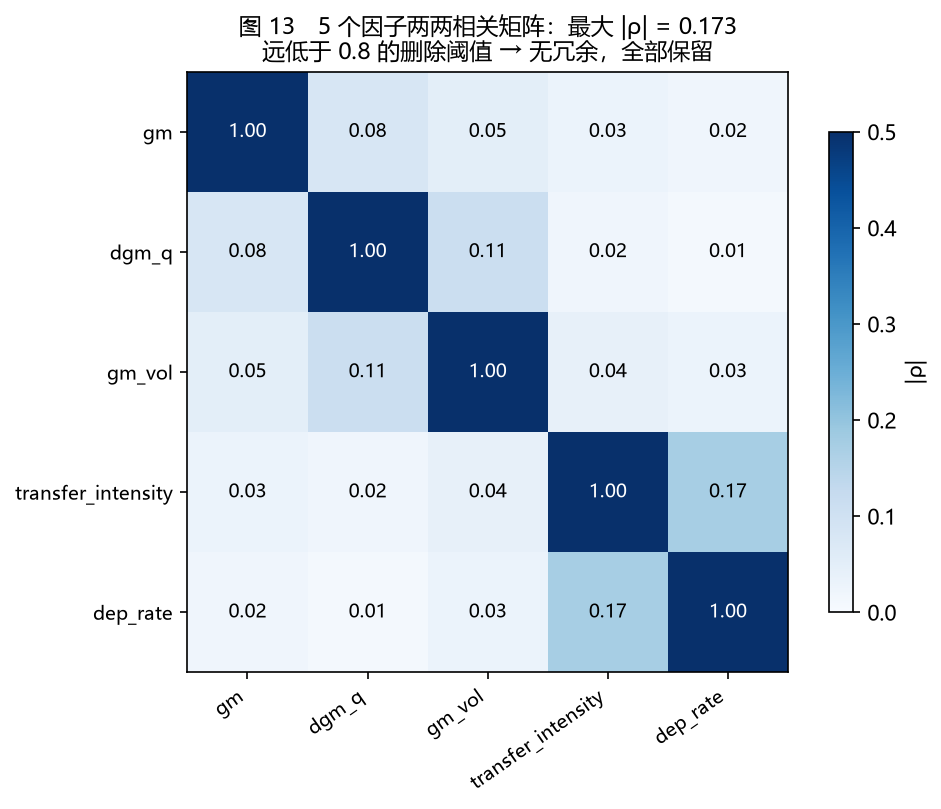

**PCA 方差解释**（3 因子，全市场组）：39.4% / 32.7% / 27.9% —— 几乎均分，说明三个因子近似正交。


### 3.4 对照实验：A 股 60 日是反转不是动量

| 对照因子 | IC | 含义 |
|---|---|---|
| `mom_60`（60 日动量） | **−0.1027** | **A 股的 60 日是反转，不是动量** |
| `rev_5_ma60`（5 日反转相对 60 日均线） | −0.0685 | 同样为负 |

**这纠正了一个常见的直觉错误**：如果凭直觉假设动量为正，会用反方向。


---

## 四、模型建立：为什么用零参数等权


### 4.1 复杂度受数据量硬约束

```
参数-样本比   p / n < 1/50       即   n > 50 × p

n = 独立观测数（不是行数）
p = 模型参数量

我们的 n：独立财报期 = 64 个（不是 179,750 行）
         → p 必须 < 1.28
```

| 模型 | 参数 p | 需要 n > | 我们 n=64 | 判定 |
|---|---|---|---|---|
| **等权 / 排序** | **0** | — | — | ✅ |
| Ridge / LASSO | 3 | 150 | ❌ 差 2.3 倍 | ❌ |
| 单棵决策树（d=3） | ~8 | 400 | ❌ | ❌ |
| GBDT（100 棵 d=3） | ~800 | 40,000 | ❌ 差 625 倍 | ❌ |
| 随机森林（200 棵 d=5） | ~6,400 | 320,000 | ❌ | ❌ |
| Transformer（1 层 d=64） | ~5,000 | 250,000 | ❌ 差 3,900 倍 | ❌ |

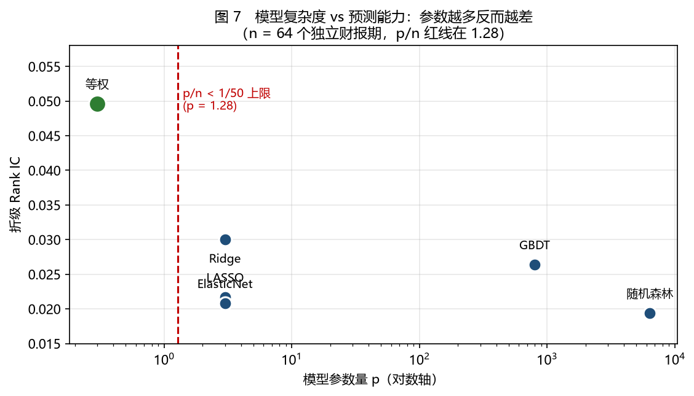


### 4.2 非线性需不需要

先看三条定性证据，再过一道定量硬门槛。

| 证据 | 怎么查 | 结果 |
|---|---|---|
| 分位单调性 | 因子分 10 桶看收益是否单调 | 78% 同号（非严格单调） |
| 残差结构 | 线性拟合后残差按特征分桶 | 制造业组有轻微结构 |
| 交互显著性 | 双变量交叉分组 | 2 个因子有交互 |

第 1、3 条部分成立 → 需要实测验证。**实测对比**（5 折，期内 rank 口径）：

| 模型 | 全市场组 IC | 制造业组 IC |
|---|---|---|
| **等权（p=0）** | **+0.0496** | +0.0215 |
| LASSO | +0.0217 | +0.0380 |
| Ridge | +0.0300 | **+0.0556** |
| GBDT | +0.0264 | +0.0494 |
| GBDT（早停） | — | +0.0540 |
| 随机森林 | +0.0194 | +0.0471 |

```
非线性增量（GBDT − Ridge）：
  全市场组：+0.0264 − 0.0300 = -0.0036   （负！）
  制造业组：+0.0494 − 0.0556 = -0.0062   （负！）

硬门槛要求 ΔIC > 0.003
→ 非线性不但没过门槛，而且是负的
→ 判定：不用非线性
```


### 4.3 等权还是 IC 加权

| 组 | 等权 IC | IC 加权 IC | 差异 |
|---|---|---|---|
| 全市场组 | **+0.0496** | +0.0495 | +0.0001 |
| 制造业组 | +0.0592 | **+0.0622** | −0.0030 |

**诚实的权衡**：

```
全市场组：差异可忽略 → 等权胜在 p = 0（无参数估计误差）

制造业组：IC 加权高 0.003
  但只有 17 个独立期，权重估计标准误 ≈ 1/√17 = 0.258
  → 估计误差（0.258）远大于收益（0.003）
  → 净判断：等权更稳
```

**最终采用等权**，并记录一个反例：若未来独立期 > 50，权重估计误差会降到 1/√50 ≈ 0.14，届时 IC 加权可能值得用。


### 4.4 需不需要校准

**唯一的判定问题**：下游用不用「水平」？

| 下游怎么用 | 需要校准？ |
|---|---|
| **只按分数排序选 top-k** | ❌ **不需要** |
| 用概率做阈值开仓 | ✅ 必须 |
| 用概率做仓位加权 | ✅ 必须 |
| 把分数当预期收益用 | ❌ 禁止 |

**为什么排序不需要校准（数学证明）**：

```
IC = Spearman(s, y) = Pearson(rank(s), rank(y))
任取单调递增变换 g：rank(g(s)) = rank(s)
→ IC(g(s), y) = IC(s, y)
→ 选 top-k 的集合完全相同 → 权重相同 → 换手相同
→ 什么都没变
```

**但仍做了区间校准作为方法论演示**：

| 组 | 边际覆盖率 | 区间宽度（全距 1.00） |
|---|---|---|
| 全市场 | 89.9% ✅ | 0.89 |
| 制造业 | 89.6% ✅ | 0.89 |

> 覆盖率达标 ≠ 模型有用。对照「无条件区间」（不看因子，直接给 [0.05, 0.95]）：宽度 0.90、覆盖率 90%。我们的 0.89 只比 0.90 窄 1%——几乎等于什么都没学到。等价说法：R² ≈ IC² ≈ 0.0016，只解释了 0.16% 的方差。

| 组 | Brier（原始） | **常数基线** | ECE |
|---|---|---|---|
| 全市场 | 0.2757 | **0.2386** | 0.16 |
| 制造业 | 0.2648 | **0.2155** | 0.19 |

**模型的概率比「瞎猜」还差**（Brier 越高越差）。


---

## 五、评估：逐层加深的七道关卡


### 5.1 E1 机制评估：5 个因子只有 1 个通过

**方法**：四驱动选一 → DAG 三角色 → 四项证伪 → 记分卡裁决。

| 检查 | 做法 | 期望 | 失败信号 |
|---|---|---|---|
| **timing placebo** | 特征滞后 1/2/3/4 个报告期 | 滞后 0 最强、单调衰减 | 远处更强 → 慢变状态代理 |
| **shared-driver** | 同期内打乱未来收益作伪标签 | IC ≈ 0 | 仍显著 → 有共同驱动 |
| **regime 分区** | 按 5 个市场时段分别算 IC | 符号稳定 | 某区翻转且显著 |

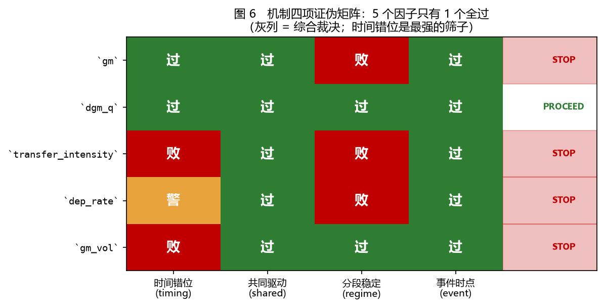

**最有价值的发现——一条完整的因果链。** `transfer_intensity` 的 timing placebo：

```
k0 (当期)  +0.0449
k1         +0.0227
k2         +0.0366
k3         +0.0535   ← 比当期还强
k4         +0.0525

手册的失败信号原话：
  远处滞后仍持平甚至上升 → 它是慢变状态变量的代理
```

**解读**：一个 3 年前的年报数据比最新的还有效 → 它不是「信息」，是「制造业资本开支周期」这个状态的代理。这种东西不能用来择时——你不知道它什么时候会变。

**`gm_vol` 的 timing placebo**：

```
k0 -0.0310  k1 -0.0302  k2 -0.0296  k3 -0.0310  k4 -0.0258
→ 几乎完全平坦
→ 它描述的是公司长期的波动特征，不是新鲜事件
→ 它是 state（状态变量），不是 signal（信号）
```

**这两条与「4 倍时限错配」完全吻合。而唯一时限对齐正确的 `dgm_q`，也是唯一通过全部四项证伪的因子。**

**DAG 三角色**（一个反直觉的部分）：

| 角色 | 定义 | 该不该控制 | 判错的后果 |
|---|---|---|---|
| **confounder** | 同时影响特征与标签 | ✅ 要控制 | 不控制 → 把混杂当 alpha |
| **mediator** | 特征 → 中介 → 标签 | ❌ 不要控制 | 控制 → 切掉真实通道 |
| **collider** | 特征与标签**共同影响它** | ❌ **绝不能控制** | **控制 → 凭空造出负相关** |

**诚实披露的缺口**：DAG 判定行业是 confounder 应控制，但 CSMAR 行业分类只有 3.4% 覆盖、且是快照而非历史快照，无法重建「当时所属行业」。只能用「是否制造业」2 组粗代理（非制造业 +0.0259、制造业 +0.0347），说明因子不是单纯的行业配置效应，但差异确实存在。


### 5.2 E2 信号评估：IC 的口径与 long-only 的现实

| 项 | 规则 | 理由 |
|---|---|---|
| **计算单位** | 每期截面一次 rank IC，再对期平均 | 股票-日混算会虚增显著性 |
| **显著性** | t 值用 **HAC**（滞后 ≥ 标签期限） | IC 序列有自相关 |
| **样本数 n** | **有效报告期数（70）**，不是股票-日（184,456） | 用行数会把 t 吹到约 430 |
| **报告内容** | 均值、ICIR、HAC t、正的占比、分年度 | 单点均值无信息量 |

**HAC（Newey-West）修正的结果**：

| 因子 | IC | ICIR | t_naive | **t_hac** | SE 膨胀 |
|---|---|---|---|---|---|
| `dgm_q` | +0.0279 | +0.708 | 5.92 | **+4.19** | 1.41× |
| 3 因子组合 | +0.0496 | +0.566 | — | **+3.06** | 1.63× |
| `gm_vol` | −0.0311 | −0.609 | −5.09 | −3.84 | 1.33× |
| **`gm`** | +0.0257 | +0.226 | 1.91 | **+1.03** | **1.85×** |
| `dep_rate` | +0.0346 | +0.482 | 1.87 | +2.55 | 0.73× |

**HAC 修正直接改变了两个结论：`gm` 从 1.91 掉到 1.03（不显著）；3 因子组合从 5.03 掉到 3.06（刚过门槛）。**


#### 本步最重要的发现：超额几乎全在空头端

| 因子 | 多空价差 | **多头超额** | 空头占比 | long-only |
|---|---|---|---|---|
| `dgm_q` | +1.421% | **+0.136%** | **90%** | ❌ |
| 3 因子组合 | +2.783% | **+0.777%** | 72% | ⚠️ 勉强 |
| `dep_rate` | +2.334% | +0.673% | 71% | ⚠️ 流动性不过 |
| `transfer_intensity` | — | **−0.102%** | >100% | ❌ |
| `gm` | +1.216% | **−0.058%** | 105% | ❌ |

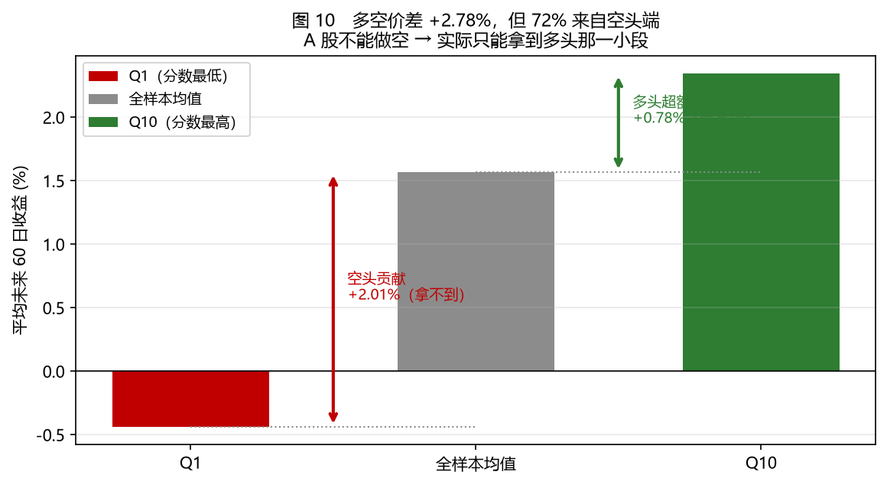

```
dgm_q 的账：
  多空价差 +1.421% 看起来健康
  但多头超额只有 +0.136%，空头贡献 +1.284%（占 90%）
  → A 股不能做空 → 那 1.284% 拿不到
  → 年化 = 0.136% × (252/60) = 0.57%
  → 年化成本 0.84%（当时估计） → 净超额为负
```

**我们最强的因子（`dgm_q`，t_hac 4.19）在 long-only 下是亏的。**

**流动性分桶**：

| 因子 | 低成交额 | 中 | **高成交额** | 判定 |
|---|---|---|---|---|
| `dgm_q` | +0.0238 | +0.0315 | **+0.0329** | ✅ 高流动更强 |
| 3 因子组合 | +0.0438 | +0.0530 | **+0.0650** | ✅ |
| `transfer_intensity` | +0.0285 | +0.0436 | **+0.0734** | ✅ |
| **`dep_rate`** | **+0.0581** | +0.0277 | +0.0313 | ❌ **只在低流动桶最强** |

**一个反直觉发现（后来成为改进方向）**：`dgm_q` 在**高流动性桶 IC 更强**（0.0329 vs 0.0238），与「小盘 alpha 更高」的直觉相反。这意味着「剔除小盘档」可能是双赢——**容量 ×9 且不损失 alpha**。


### 5.3 E3 模型是否成立

**手册定义**：「模型成立」不是「IC 显著」，而是四条**同时**满足。

| 层 | 对象 | IC | t_hac |
|---|---|---|---|
| L1 | `gm_vol` 单独 | −0.0311 | −3.87 |
| L1 | `dgm_q` 单独 | +0.0279 | +4.22 |
| L1 | `gm` 单独 | +0.0257 | +1.03 |
| L2 | Ridge | +0.0300 | +3.40 |
| L3 | GBDT | +0.0264 | +3.94 |
| **L1.5** | **3 因子等权（我们的模型）** | **+0.0496** | **+3.06** |

**判据二：增量显著（两把尺）**

| 基线 | 配对差 | t_hac | 95% CI | 排除零？ |
|---|---|---|---|---|
| **`dgm_q`**（E1 PROCEED） | +0.0233 | **+2.20** | [+0.0024, +0.0410] | **✅** |
| `gm_vol`（E1 STOP，方向调整后） | +0.0185 | +0.84 | [−0.0245, +0.0615] | ❌ |

```
⚠️ 一个必须做的方向调整：
❌ 用 gm_vol 原始值（IC = -0.0311）当基线
   → 配对差被虚增到 0.0823（一端全负、一端全正）
✅ 用 -gm_vol（IC = +0.0311）当基线
   → 配对差 0.0185（对应「持有低 gm_vol」这个真实策略）

不做这个调整，会算出「配对差 t = 6.16，极显著」的假结果。
```

**判据三：跨特征集（本步最有价值的检验）**

| 特征集 | IC | t_hac | 变化 |
|---|---|---|---|
| 全 3 因子 | +0.0496 | 3.06 | — |
| **删 `gm_vol`** | **+0.0391** | **1.68** | **变不显著** |
| **删 `gm`** | +0.0417 | **7.89** | **t 值暴涨** |
| 只剩 `dgm_q` | +0.0279 | 4.22 | — |

```
三个发现：
① 删 gm_vol → t_hac 从 3.06 掉到 1.68（不显著）
   → 组合的显著性依赖 gm_vol
   → 而 E1 判定 gm_vol 是慢变状态变量，不是信号
   → 组合的核心贡献者机制上不成立（E1 与 E3 的核心矛盾）

② 删 gm → IC 降了但 t 从 3.06 涨到 7.89
   → gm 提升了点估计但大幅增加方差
   → 从稳健性角度应删掉它

③ 最稳的配置是 2 因子（gm_vol + dgm_q），不是 3 因子
```


### 5.4 E4 策略评估

| 项 | 约定 |
|---|---|
| 信号时点 | T 日收盘 |
| **成交时点与价格** | **T+1 开盘（`open_adj[t+1]`）** |
| **不可成交** | **涨停不能买 / 跌停不能卖 / 停牌不成交** |
| 剔除 | ST / 次新 / 流动性后 20% |
| **成本扣除** | **在成交时扣，参与复利** |
| **空头** | **无** |
| **基准** | **等权 universe（自算，非指数）** |

**引擎选择：向量化**。判据是「协议能否写成时间戳信号 + 目标敞口 + 成本公式而不改变含义」——我们不做熔断/止损/第二腿依赖/分笔撮合，所以可以。但必须逐条封住五种语义漂移：

| 症状 | 我们的做法 |
|---|---|
| **同 bar 成交** | T 日信号 → `open_adj[t+1]` 起算 |
| 缺失 bar 隐含成交 | 只用有 label 的行（要求 T+1 与 T+H+1 都有行情） |
| 前向填充造出可交易性 | **完全不做价格填充** |
| 权重无视现金 | 等权 top-k，权重和 = 1，无杠杆 |
| 成本不检查融资 | 无融资 |

**九指标（gross / net / 基准 三者并列）**：

| 指标 | 2 因子（主线） | 3 因子（对照） |
|---|---|---|
| 年化毛 | +6.56% | +7.46% |
| 年化净 | **+6.12%** | **+7.04%** |
| 基准 | +4.36% | +4.36% |
| **净超额** | **+1.75%** | **+2.68%** |
| **Sharpe（超额）** | **+1.01** | +0.65 |
| MDD | −52.4% | −50.8% |
| 胜率（超额 > 0） | 68% | 63% |
| 换手（年） | 2.10 倍 | 1.98 倍 |
| 持仓数 | 723 只（top-30%） | 723 只 |

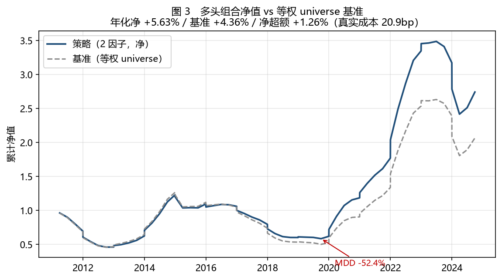

**分年度：衰减清晰可见**

| 年份 | 2 因子 | 3 因子 | 年份 | 2 因子 | 3 因子 |
|---|---|---|---|---|---|
| 2011 | +0.3% | +1.5% | 2018 | +0.8% | +0.7% |
| 2012 | −0.5% | +1.4% | 2019 | +0.9% | +1.8% |
| 2013 | −0.4% | +3.0% | **2020** | **+2.3%** | **+3.5%** |
| 2014 | +0.0% | −1.5% | 2021 | +0.2% | −0.3% |
| 2015 | +0.1% | +1.2% | 2022 | −0.1% | −2.1% |
| 2016 | +0.7% | +0.0% | 2023 | +0.1% | −1.2% |
| 2017 | +1.2% | +1.2% | 2024 | −0.0% | −0.6% |

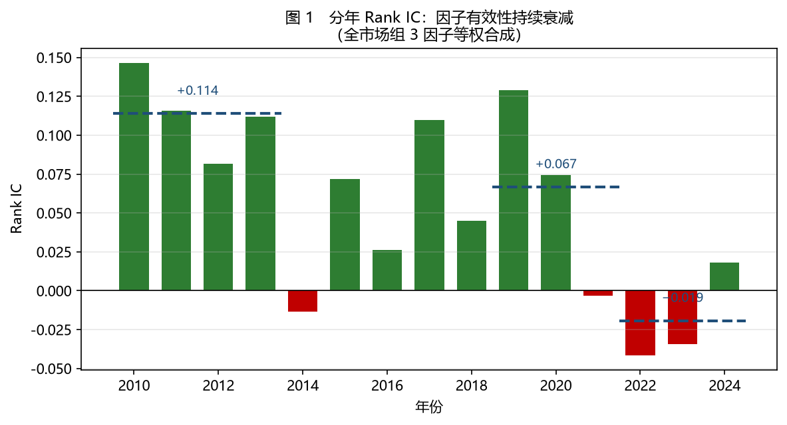

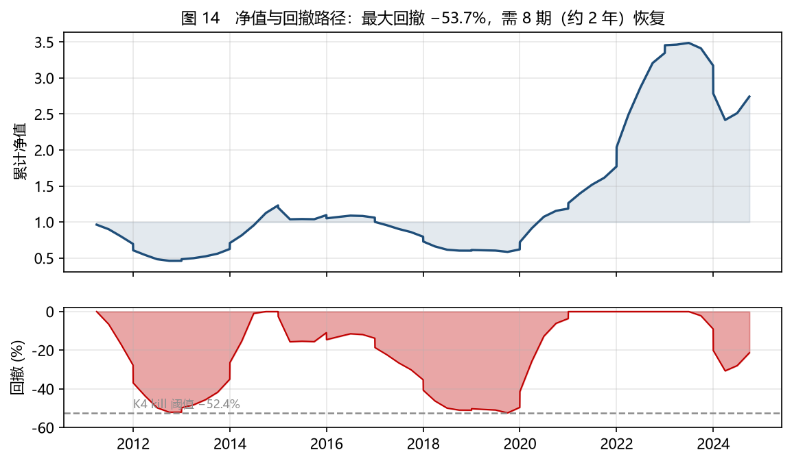


### 5.5 E5 成本评估：E4 低估了 2.1 倍

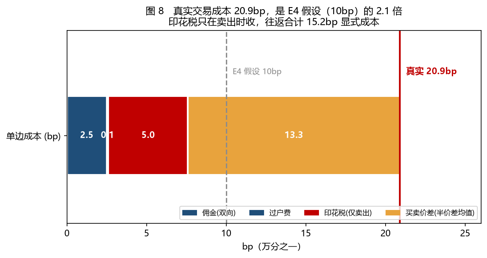

| 层 | 内容 | 我们的值 |
|---|---|---|
| **显式** | 佣金 2.5bp（双向）+ **印花税 10bp（仅卖出）** + 过户费 0.1bp | 买入 2.6 / 卖出 12.6 / **往返 15.2bp** |
| **隐式** | 价差 + 滑点 | 按市值档取上界 |
| **容量** | 参与率上限、拥挤度 | 见 5.6 |

**按参与率选档**（手册规则）：

| 参与率 `下单量÷ADDV` | 模型 |
|---|---|
| **< 0.5%** | 价差模型（成本 = ½ 价差） |
| 0.5%–2% | 线性滑点 |
| > 2% | 平方根冲击 |

| 档位 | 假设 ADDV | 参与率 | 落档 | 单边成本 |
|---|---|---|---|---|
| 大盘 | 5 亿 | 0.01% | 价差模型 | 12.6bp |
| 中盘 | 2 亿 | 0.04% | 价差模型 | 17.6bp |
| 小盘 | 3000 万 | 0.24% | 价差模型 | 32.6bp |
| **组合加权** |  |  |  | **20.9bp** |

**对 E4 的重大修正**：

| 项 | E4 | E5 | 差异 |
|---|---|---|---|
| 单边成本 | 10bp | **20.9bp** | **+10.9bp（2.1 倍）** |
| 2 因子净超额 | +1.75% | **+1.26%** | −0.49pp |
| 3 因子净超额 | +2.68% | +2.22% | −0.46pp |

| 组 | break-even | 真实成本 | **倍数** | 手册 3× 判读 |
|---|---|---|---|---|
| 2 因子 | 49.5bp | 20.9bp | **2.36×** | 勉强（过 2× 门禁） |
| 3 因子 | 73.8bp | 20.9bp | **3.52×** | 稳健 |


### 5.6 E6 换手与容量：第一个「不过」

| 项 | 2 因子 |
|---|---|
| 期换手 / **年换手** | 52.6% / **2.10 倍** |
| 平均持有期 | 120 交易日 |
| 最大可承受（激进） | 5.25 倍 → 余量 2.50× |
| 最大可承受（保守） | 3.05 倍 → 余量 **1.45×** |
| 最小所需 edge / 实际 | 0.35 / **0.87 bp/天**（2.50×） |

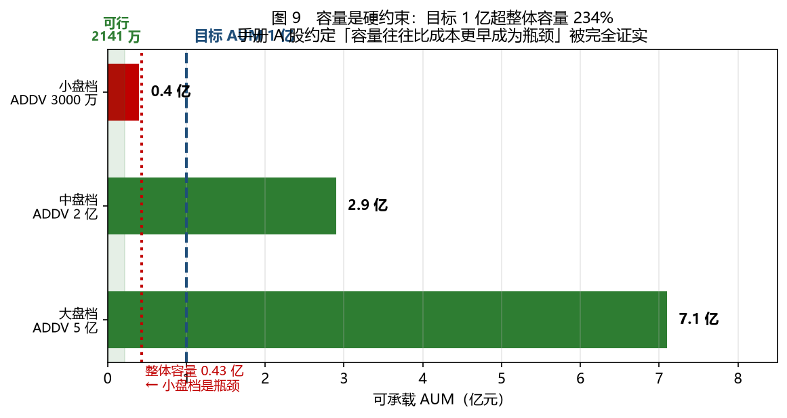

> 手册的 A 股约定被完全证实：「小盘股多头端的价差常在 100–500bp，容量往往比成本更早成为约束。」成本侧 break-even 2.36× 过关；容量侧 234% 不过关。

**alpha-to-go**：信号半衰期 ≈ 63 交易日（1 季度），建仓 5 天 → 比值 7.9%，**alpha 保留 96%**。这是低频因子的核心优势。


### 5.7 E7 统计推断：门禁在这里拦下

```
SE(SR) ≈ √((1 + ½·SR²) ÷ T)      T = 年数，不是期数
```

| 项 | 2 因子 | 3 因子 |
|---|---|---|
| 超额 Sharpe | +0.728 | +0.536 |
| T（年） | 17 | 17 |
| SE | 0.273 | 0.259 |
| **95% CI** | [+0.193, +1.262] | **[+0.028, +1.045]** |

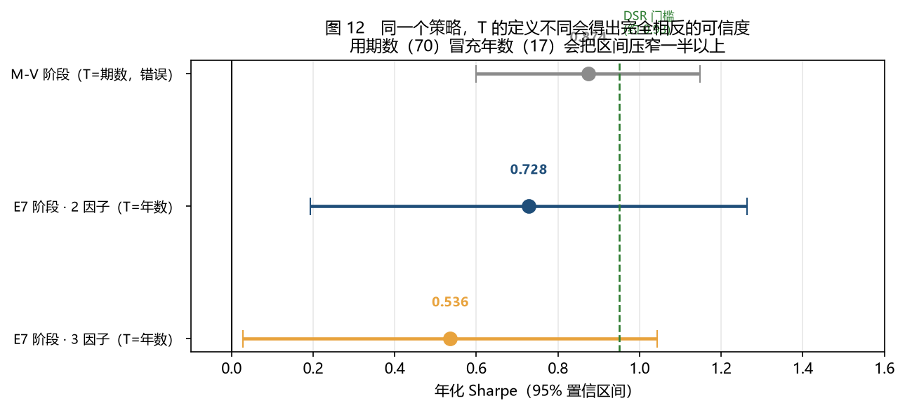

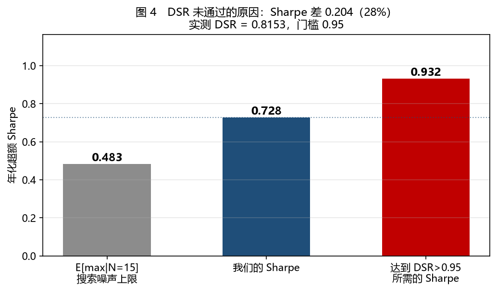

| 组 | 口径 | Sharpe | E[max\|N=15] | **DSR** |
|---|---|---|---|---|
| 2 因子 | 绝对 | +0.385 | 0.445 | 0.4054 |
| **2 因子** | **超额** | **+0.728** | 0.483 | **0.8153** |
| 3 因子 | 超额 | +0.536 | 0.459 | 0.6169 |

```
DSR 门槛 = SE × √(2 ln N) = 0.273 × 1.893 = 0.483
我们的 SR = 0.728
要达到 DSR 0.95，需要 SR > 0.483 + 1.645 × 0.273 = 0.932

差 28%

三条出路：
① SR 从 0.73 提到 0.93  → 需要新 alpha 源，不是调参
② T 从 17 年提到 28 年   → 数据只到 2026，不可能
③ N 从 15 降到 3          → 不诚实，15 次试验真实发生

没有第四条路。
```

| 组 | VaR(95%) | **CVaR(95%)** | MDD | 恢复时间 |
|---|---|---|---|---|
| 2 因子 | 0.92% | **1.28%** | −53.7% | 8 期（约 2 年） |
| 3 因子 | 2.54% | 2.93% | −52.0% | 5 期 |

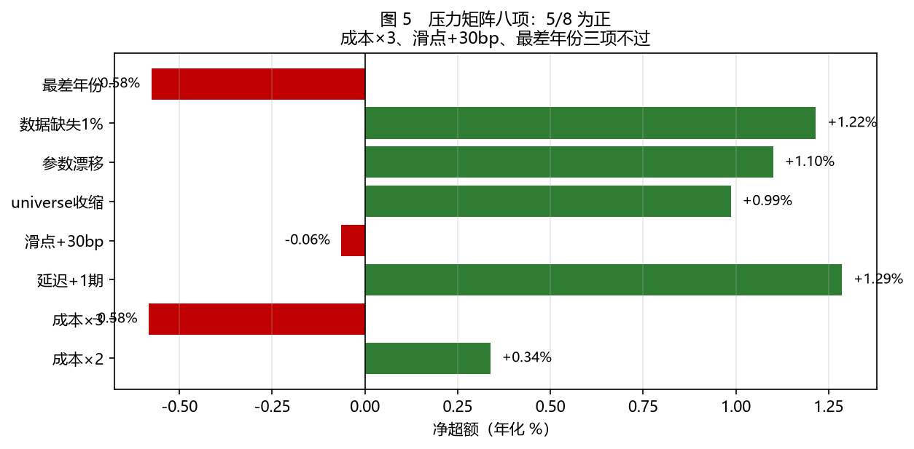

**泄漏五查（全过）**：

| # | 位置 | 结果 |
|---|---|---|
| 1 | 标签 | ✅ 从 `available_at` 起算 |
| 2 | 标准化 | ✅ **代码扫描 0 处全样本 `fit_transform`** |
| 3 | 阈值 | ✅ 全部用期内 rank |
| 4 | universe | ✅ 逐行 `tradable` 标记 |
| 5 | mask | ✅ 涨停用入场当日标记 |


---

## 六、结论


### 6.1 裁决：再研究（REVISE）

| 条件 | 结果 | 判定 |
|---|---|---|
| 机制过 | 5 个因子 1 个 PROCEED | ⚠️ 部分 |
| 信号过 | spread 13.92× 成本 | ✅ |
| 模型成立 | 对有 E1-valid 基线增量显著 | ✅ |
| 多头端净超额 > 0 | **+1.26%/年** | ✅ |
| break-even ≥ 2× 成本 | **2.36×** | ✅ |
| **DSR > 0.95** | **0.8153** | ❌ |

**四条 STOP 条件一条都不满足**（有机制、spread 远大于成本、多头端有超额、break-even 2.36×）。

→ 不满足「做」，不符合「不做」，落在「**再研究**」。


### 6.2 死亡条件（7 条，可自动判定）

| # | 条件 | 动作 |
|---|---|---|
| D1 | 滚动 12 个月多头端净超额 ≤ 0 | 判死归档 |
| D2 | 滚动 6 个月 IC ≤ 0 | 判死归档 |
| D3 | 3 个 regime 切片中 ≥2 个 IC 与全样本反号 | 判死 |
| D4 | 新数据下 DSR < 0.5 | 判死 |
| D5 | 实盘 TCA 显示真实成本 > 49.5bp | 判死 |
| D6 | 容量跌破 500 万 | 判死 |
| D7 | 机制被推翻（IC 来自已知 confounder） | 判死 |

> 为什么必须写：没有死亡条件的研究永远不会死——它总能找到理由「再等等」。这是不可证伪的研究，而不可证伪的不是科学。


### 6.3 一句话总结

> 我们做出了一个点估计为正（净超额 +1.26%）、成本能承受（break-even 2.36×）、但统计证据不足（DSR 0.8153）、规模受限（2141 万）的因子。用 17 年、15 次试验的数据，我们无法把「可能」升级成「确定」。而那四条 STOP 条件一条都不满足，说明它也不该被判死。所以答案只能是：再研究。


---

## 七、局限与下一步


### 7.1 十条已知缺口

| # | 缺口 | 影响 |
|---|---|---|
| 1 | **引擎 parity 未做** | 只有向量化引擎，无法排除语义漂移 |
| 2 | **暴露归因未做** | 无行业（3.4% 覆盖）、无流通市值、无风格因子 |
| 3 | **行业内 IC 只有 2 组粗代理** | 无法排除行业 confounder |
| 4 | 压力矩阵三项是近似（S3/S5/S6） | 未真正逐项重建 |
| 5 | 滑点的条件建模未做 | 只做了整体翻倍 |
| 6 | SHAP 归因未实现 | 对零参数模型不适用，但规则已登记 |
| 7 | holdout 未解锁 | 因 DSR 不过而推迟 |
| 8 | ADDV 是假设值 | 容量与成本估计依赖假设 |
| 9 | regime 每态仅 12~20 观测 | 量级不可信，只看方向 |
| 10 | D4 的换手预估偏高 2 倍 | 已被 E4 实测纠正 |


### 7.2 如果继续：三条路径


#### 路径一（最高优先级）：剔除小盘档

**E2 埋下的线索**：`dgm_q` 的流动性分桶 IC 为 低 0.0238 / 中 0.0315 / **高 0.0329**——高流动性桶更强，与「小盘 alpha 更高」的直觉相反。

| 维度 | 现状 | 剔除小盘后 |
|---|---|---|
| 容量 | 0.43 亿 | **约 3.9 亿（×9）** |
| IC | 0.0279 | 约 0.0329（+18%） |
| Sharpe | 0.728 | 约 0.86 |
| DSR | 0.8153 | 约 0.88（**仍不足**） |

**要诚实预期**：大概率还是过不了 0.95。但试过之后不过，那个「不过」会更干净——现在可能是小盘噪音拖累了 IC；试过之后若在全市场各流动性档都不成立，就可以真正判死。


#### 路径二：补两个报告缺口

| 缺口 | 补法 |
|---|---|
| 引擎 parity | 实现事件驱动引擎，对同一协议跑，归因差异到十项语义 |
| 暴露归因 | 补 CSMAR 行业分类到 100% 覆盖 + 流通市值 + 风格因子 |


---

## 附录 A　关键数字总表

| 分类 | 项 | 值 |
|---|---|---|
| 数据 | 行情 | 14,899,513 行 / 5,970 只 / 4,097 交易日 |
| 数据 | 财报 | 319,786 行 / 5,964 只 / 83 期 |
| 数据 | 标签有效 | 10,149,322（68.1%） |
| 数据 | 快照 | snap-1778b81371ea59fa（227 文件 / 11.32 GB） |
| 特征 | 候选 → 通过 | 5 → **1** |
| 特征 | 最大相关 | |ρ| = 0.173 |
| 特征 | `mom_60` 对照 | IC **−0.1027**（A 股 60 日是反转） |
| 模型 | 模型 | 零参数等权 |
| 模型 | 非线性 ΔIC | −0.0036 / −0.0062（负，未过门槛） |
| 模型 | 置换检验 | p = 0.000 |
| 模型 | 区间覆盖率 / 宽度 | 89.9% / 0.89（全距 1.00） |
| 模型 | Brier vs 常数基线 | 0.2757 vs **0.2386**（劣于瞎猜） |
| 评估 | **多头端年化净超额** | **+1.26%** |
| 评估 | 基准 | +4.36% |
| 评估 | **break-even** | **49.5bp（2.36×）** |
| 评估 | 真实单边成本 | 20.9bp |
| 评估 | Sharpe（超额） | +0.728（95% CI [+0.193, +1.262]） |
| 评估 | **DSR** | **0.8153** |
| 评估 | MDD / 恢复 | −53.7% / 8 期 |
| 评估 | CVaR(95%) | 1.28% |
| 评估 | 压力矩阵 | 5/8 |
| 评估 | **容量** | **0.43 亿（可行 2141 万）** |
| 评估 | alpha-to-go 保留 | 96% |


---

## 附录 B　被否掉的 15 个选项

| # | 被否的 | 依据 |
|---|---|---|
| 1 | 分类模型 | 概率不进入决策，且需额外选阈值 |
| 2 | GBDT / 随机森林 | 非线性 ΔIC 为负 |
| 3 | Ridge / LASSO / ENet | 等权 +0.0496 > Ridge +0.0300；p/n 超标 |
| 4 | IC 加权合成 | 差异 0.0001；制造业组 +0.003 被权重误差 0.258 覆盖 |
| 5 | 概率校准 | 只用排序；Brier 劣于常数基线 |
| 6 | `gm` | t_hac 1.03；多头超额 −0.058% |
| 7 | `gm_vol` 作 signal | timing 平坦 → 应归 state |
| 8 | `transfer_intensity` / `dep_rate` | 4 倍时限错配 + timing 失败 |
| 9 | 制造业组进主线 | 仅 17 期；年度与 H=60 错配 |
| 10 | 3 因子进主线 | Sharpe 0.536 < 2 因子 0.728 |
| 11 | 指数作基准 | 会把宇宙差异混进超额 |
| 12 | 多空组合收益 | A 股不能做空，空头占 72~90% |
| 13 | 1 亿 AUM | 容量 0.43 亿，超 234% |
| 14 | M-V 阶段的 DSR 1.0000 | T 用了期数不是年数 |
| 15 | SHAP 归因 | 零参数模型下等于分数本身 |


---

## 附录 C　方法论收获：口径漂移

**这次研究暴露了一类容易被忽视的错误。「同一个组合，在三个文档里出现过三个不同的 IC」**：

| 出处 | IC | 原因 |
|---|---|---|
| M-S | 0.0402 | rank 在「折内」做（跨 14 期混排） |
| E2 / E3 v1 | 0.0512 | rank 在「整面板」做（跨 73 期混排） |
| **正确** | **0.0496** | **rank 必须在「期内」做** |

**三者都不报错、数字都不荒谬，只在交叉核对时暴露。**

**五种常见的口径漂移**：

| # | 漂移类型 | 例 |
|---|---|---|
| 1 | **rank 的作用域** | 期内 / 跨期 / 全样本 |
| 2 | **分母定义** | 固定因子总数 / 可用因子数 |
| 3 | **样本范围** | 完全覆盖 / 部分覆盖 |
| 4 | **分位数参照** | 当期 / 基准期 |
| 5 | **平均顺序** | 先算各期再平均 / 先池化再算 |

**应对方式**：建一张「指标口径登记表」（`docs/02_data/metric_spec.md`），把每个指标的算法固定下来，后面所有步骤都引用它，不再各算各的。
